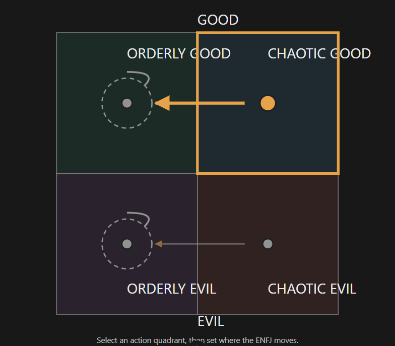

# The ENFJ pretty boy, the warehouse owner's son (unnamed; file is `enfj-m.md` until Rex names him)

Every field is marked **(Rex)**, **(proposed)** or **(open)**. Only (Rex) is canon. The field keys in backticks
follow `_TEMPLATE.md`.

- **Slot:** `enfj-m` (file was `enfj.md` until 2026-10-27)
- **Status:** idea
- **Last changed:** 2026-10-27

## Identity

| Field | Key | Value | Mark |
|---|---|---|---|
| Name | `name` | | open |
| Type | `type` | ENFJ | Rex |
| Function stack | `stack` | Fe-Ni-Se-Ti | Rex (type) |
| Gender | `gender` | man | Rex |
| Pirate archetype | `archetype` | | open |
| Ship job (posts held) | `posts` | | open |
| Where they are found | `found_at` | the starting port: the warehouse, his father's | Rex |
| Resident or visitor | `town_role` | resident | Rex |

## The psycho

| Field | Key | Value | Mark |
|---|---|---|---|
| Psycho core | `psycho_core` | the type's killer form, in this character | open |
| Madness break | `madness_break` | what they do when the meter crosses the line | open |
| Madness triggers | `madness_triggers` | | open |
| Why piracy allows it | `permission` | how the setting makes it permissible | open |
| Their slight | `slight` | the thing that, repeated, makes them leave | open |
| Clues to the slight | `slight_clues` | obvious, subtle, too late | open |

## The person

| Field | Key | Value | Mark |
|---|---|---|---|
| Bio | `bio` | son of the warehouse owner; isn't being taught well by his disorganised, chaotic father. Earlier note (the bigwig's child): extremely troubled, a legit drain on the town, a recruitable who needs fixing to help the town | Rex |
| Likes (gifts, acts) | `likes` | | open |
| Dislikes | `dislikes` | | open |
| Schedule | `schedule` | their day: post, meals, the den, sleep | open |
| Claims vs truth | `claims` | what they say they're good at, and whether it's true | open |

### His journey (Rex, 2026-10-27)

- **(Rex)** His journey is into making structure: he either turns the warehouse into a place for goods and legitimate trade, or uses it to house illegally stolen goods, drugs and such.
- **(Rex)** The journey is the son's (confirmed 2026-10-27).

## Joining

| Field | Key | Value | Mark |
|---|---|---|---|
| How recruited | `recruit` | hire / mercenary / kidnap; what they need first (rep, proof, gift, questline) | open |
| What the town thinks of them | `town_view` | who likes them, who doesn't (kidnapping consequences) | open |

## Relationships

One row per other character Rex has tied them to. Affection, respect, rivalry, distrust, history.

| With | Key | What it is | Mark |
|---|---|---|---|
| the player | `rel.player` | | open |
| his father, the warehouse owner (`bigwig`) | `rel.bigwig` | his father isn't teaching him well | Rex |

## Heart events

| Hearts | Key | Scene | Mark |
|---|---|---|---|
| | `heart_events` | | open |

## Voice

| Field | Key | Value | Mark |
|---|---|---|---|
| Speech notes | `voice` | rhythm, vocabulary, what they never say | open |
| Keywords they answer | `keywords` | Morrowind-style topics, and what trust each needs | open |
| Sample lines | `lines` | Rex's lines only | open |

## Art notes (for the art keeper)

| Field | Key | Value | Mark |
|---|---|---|---|
| Look | `art.look` | a pretty boy | Rex |
| Signature face | `art.signature_face` | the one expression that is theirs | open |
| Heart-event scenes to illustrate | `art.scenes` | | open |

## Questline responses

How they react to what they witness you do on each of the four questlines (model and matrix:
`../QUESTLINES.md`; town system: `../../town/ENDINGS.md`; personality shifts: `../../STATS.md` §3). Rex,
2026-10-27: conduct on each path decides alignment, and crew who witness it move by their own inner rules.
Rex's rule: a character's nature isn't corrupted by the quest they go on.

| Questline | Key | Reaction to what they witness you do there | Mark |
|---|---|---|---|
| Orderly good (church-like) | `quest.order_good` | stays orderly good (loop) | Rex |
| Chaotic good (the stereotypical pirate town) | `quest.chaos_good` | moves them to orderly good | Rex |
| Orderly evil (Cthulhu corruption) | `quest.order_evil` | stays orderly evil (loop) | Rex |
| Chaotic evil (killers, devil worship) | `quest.chaos_evil` | moves them to orderly evil | Rex |

### Inner rules: the alignment map (Rex, 2026-10-27)

What the path you push them on does to their alignment (`../QUESTLINES.md`, model point 4). Rex's diagram:



```
              GOOD
   +-----------------+-----------------+
   |  ORDERLY GOOD   |  CHAOTIC GOOD   |
   |   (OG) <--------+------ (CG)      |
   |   loop          |                 |
   +-----------------+-----------------+
   |   (OE) <--------+------ (CE)      |
   |   loop          |                 |
   |  ORDERLY EVIL   |  CHAOTIC EVIL   |
   +-----------------+-----------------+
              EVIL
   OG stays   CG->OG   OE stays   CE->OE
```

| Pushed on (action quadrant) | They move toward | Mark |
|---|---|---|
| Orderly good | orderly good (stays: a loop) | Rex |
| Chaotic good | orderly good | Rex |
| Orderly evil | orderly evil (stays: a loop) | Rex |
| Chaotic evil | orderly evil | Rex |

For the code (`inner_rules`, action → destination):
`{ "order_good": "order_good", "chaos_good": "order_good", "order_evil": "order_evil", "chaos_evil": "order_evil" }`

- **(open)** Their natural alignment. This map has two loops (orderly good and orderly evil): everything pulls
  them toward order, and the good/evil side follows what you do.

## Change log

| Date | Change | By |
|---|---|---|
| 2026-10-27 | Created with the alignment map (OG stays, CG→OG, OE stays, CE→OE) | Rex |
| 2026-10-27 | A man, a pretty boy; file moved from `enfj.md` to `enfj-m.md` | Rex |
| 2026-10-27 | He is the warehouse owner's son (the bigwig's child); his journey into making structure: the warehouse for legitimate trade, or for stolen goods and drugs | Rex |
| 2026-10-27 | Confirmed: the journey into making structure is his | Rex |
