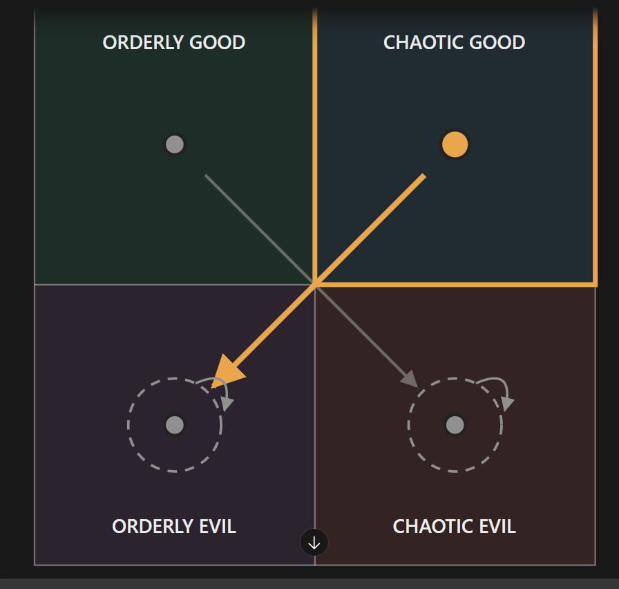

# The evil ENTJ priest (unnamed; file is `entj-m.md` until Rex names him)

Every field is marked **(Rex)**, **(proposed)** or **(open)**. Only (Rex) is canon. The field keys in backticks
follow `_TEMPLATE.md`.

- **Slot:** `entj-m`
- **Status:** idea
- **Last changed:** 2026-10-28

## Identity

| Field | Key | Value | Mark |
|---|---|---|---|
| Name | `name` | | open |
| Type | `type` | ENTJ | Rex |
| Function stack | `stack` | Te-Ni-Se-Fi | Rex |
| Gender | `gender` | man (Rex: "his chart") | Rex |
| Pirate archetype | `archetype` | the evil priest | Rex |
| Ship job (posts held) | `posts` | a priest; competes with the ISTJ priest for the church | Rex |
| Where they are found | `found_at` | starting port / later port / at sea | open |
| Resident or visitor | `town_role` | resident, visitor, looking for work | open |

## The psycho

| Field | Key | Value | Mark |
|---|---|---|---|
| Psycho core | `psycho_core` | the type's killer form, in this character | open |
| Madness break | `madness_break` | what they do when the meter crosses the line | open |
| Madness triggers | `madness_triggers` | | open |
| Why piracy allows it | `permission` | how the setting makes it permissible | open |
| Their slight | `slight` | the thing that, repeated, makes them leave | open |
| Clues to the slight | `slight_clues` | obvious, subtle, too late | open |

## The person

| Field | Key | Value | Mark |
|---|---|---|---|
| Bio | `bio` | | open |
| Likes (gifts, acts) | `likes` | | open |
| Dislikes | `dislikes` | | open |
| Schedule | `schedule` | their day: post, meals, the den, sleep | open |
| Claims vs truth | `claims` | what they say they're good at, and whether it's true | open |

## Joining

| Field | Key | Value | Mark |
|---|---|---|---|
| How recruited | `recruit` | hire / mercenary / kidnap; what they need first (rep, proof, gift, questline) | open |
| What the town thinks of them | `town_view` | who likes them, who doesn't (kidnapping consequences) | open |

## Relationships

One row per other character Rex has tied them to. Affection, respect, rivalry, distrust, history.

| With | Key | What it is | Mark |
|---|---|---|---|
| the player | `rel.player` | | open |
| the ISTJ priest (`istj-m`) | `rel.istj-m` | rivals: he competes with the ISTJ for the church | Rex |

## Heart events

| Hearts | Key | Scene | Mark |
|---|---|---|---|
| | `heart_events` | | open |

## Voice

| Field | Key | Value | Mark |
|---|---|---|---|
| Speech notes | `voice` | rhythm, vocabulary, what they never say | open |
| Keywords they answer | `keywords` | Morrowind-style topics, and what trust each needs | open |
| Sample lines | `lines` | Rex's lines only | open |

## Art notes (for the art keeper)

| Field | Key | Value | Mark |
|---|---|---|---|
| Look | `art.look` | build, face, hair, scars, outfit, colours | open |
| Signature face | `art.signature_face` | the one expression that is theirs | open |
| Heart-event scenes to illustrate | `art.scenes` | | open |

## Questline responses

How they react to what they witness you do on each of the four questlines (model and matrix:
`../QUESTLINES.md`; town system: `../../town/ENDINGS.md`; personality shifts: `../../STATS.md` §3). Rex,
2026-10-27: conduct on each path decides alignment, and crew who witness it move by their own inner rules.
Rex's rule: a character's nature isn't corrupted by the quest they go on.

| Questline | Key | Reaction to what they witness you do there | Mark |
|---|---|---|---|
| Orderly good (church-like) | `quest.order_good` | moves him to chaotic evil | Rex |
| Chaotic good (the stereotypical pirate town) | `quest.chaos_good` | moves him to orderly evil | Rex |
| Orderly evil (Cthulhu corruption) | `quest.order_evil` | leans him toward orderly evil; kept up, the lean carries him all the way into it | Rex |
| Chaotic evil (killers, devil worship) | `quest.chaos_evil` | leans him toward chaotic evil; kept up, the lean carries him all the way into it | Rex |

### Inner rules: his alignment map (Rex, 2026-10-28)

What the path you push him on does to his alignment (`../QUESTLINES.md`, model point 4). Rex's diagram:



```
              GOOD
   +-----------------+-----------------+
   |  ORDERLY GOOD   |  CHAOTIC GOOD   |
   |      (OG)       |       (CG)      |
   |          \      |      /          |
   +-----------\-----+-----/-----------+
   |             \   |   /             |
   |               X (crossing)        |
   |             /   |   \             |
   |   ( (OE) ) <    |    > ( (CE) )   |
   |  ORDERLY EVIL   |  CHAOTIC EVIL   |
   +-----------------+-----------------+
              EVIL
   OG->CE   CG->OE   OE lean   CE lean
```

| Pushed on (action quadrant) | He moves toward | Mark |
|---|---|---|
| Orderly good | chaotic evil | Rex |
| Chaotic good | orderly evil | Rex |
| Orderly evil | orderly evil (a lean: kept up, it carries him all the way there) | Rex |
| Chaotic evil | chaotic evil (a lean: kept up, it carries him all the way there) | Rex |

For the code (`inner_rules`, action → destination):
`{ "order_good": "chaos_evil", "chaos_good": "order_evil", "order_evil": "order_evil", "chaos_evil": "chaos_evil" }`

- **(Rex)** Dashed ring: committing that action leans him that way; kept up, the lean carries him all the way into that quadrant.
- Every path ends in evil: the mirror of the ISTJ priest, whose every path ends in good.
- **(open)** Starting alignment: to figure out later. The diagram highlights chaotic good (on the CG→OE arrow); Rex hasn't said whether that marks his start.
- **(open)** Whether he is recruitable or romanceable (the 12 recruitables are 6 men and 6 women); until Rex says, he is not counted among them.

## Change log

| Date | Change | By |
|---|---|---|
| 2026-10-28 | Created: the evil ENTJ priest, who competes with the ISTJ priest for the church; alignment map (OG→CE, CG→OE, OE lean, CE lean) | Rex |
