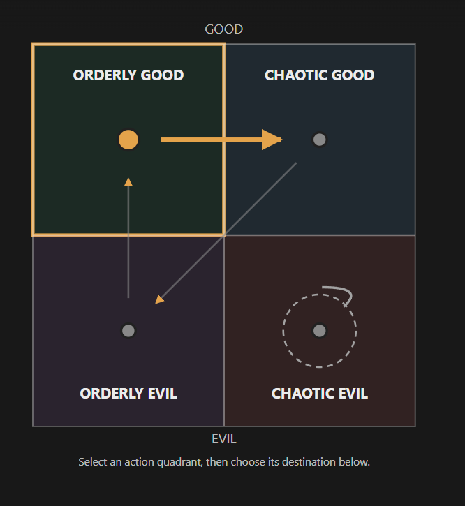

# The ENTP who keeps leaving (unnamed; file is `entp-m.md` until Rex names him, then it becomes `<slug>.md`)

Every field is marked **(Rex)**, **(proposed)** or **(open)**. Only (Rex) is canon. Field keys follow
`_TEMPLATE.md`.

- **Slot:** `entp-m`
- **Status:** idea
- **Last changed:** 2026-10-26

## Identity

| Field | Key | Value | Mark |
|---|---|---|---|
| Name | `name` | | open |
| Type | `type` | ENTP | Rex |
| Function stack | `stack` | Ne-Ti-Fe-Si | Rex (type) |
| Gender | `gender` | man | Rex |
| Pirate archetype | `archetype` | a builder of devices (replaces the ROSTER draft's "card sharp" for him) | Rex |
| Ship job (posts held) | `posts` | mechanic: he builds interesting, effective killing devices for the boat. In town: the local weaponsmith | Rex |
| Where they are found | `found_at` | the starting port: he lives at the shipyard (a few other shipyard characters live there too); each time he leaves, you find him back in town | Rex |
| Resident or visitor | `town_role` | resident (the shipyard) | Rex |

## The psycho

| Field | Key | Value | Mark |
|---|---|---|---|
| Psycho core | `psycho_core` | his defining trait: he constructs devices, and some are truly terrifying means of torturing life. His work for the boat is killing devices; his more focused creations are clearly devices of torture | Rex |
| Madness break | `madness_break` | | open |
| Madness triggers | `madness_triggers` | | open |
| Why piracy allows it | `permission` | | open |
| Their slight | `slight` | | open |
| Clues to the slight | `slight_clues` | | open |

## The person

| Field | Key | Value | Mark |
|---|---|---|---|
| Bio | `bio` | | open |
| Likes (gifts, acts) | `likes` | | open |
| Dislikes | `dislikes` | | open |
| Schedule | `schedule` | | open |
| Claims vs truth | `claims` | | open |
| Sliders | `sliders` | high fickleness, low loyalty (Loyal ↔ Fickle sits far toward Fickle) | Rex |

## Joining

| Field | Key | Value | Mark |
|---|---|---|---|
| How recruited | `recruit` | first time: you convince him through dialogue (a complex dialogue tree; the INTJ's is the other). He has been thinking about joining a crew but feels he's not ready to put his weaponry to the test; he's been tinkering for two years and isn't sure he's ready. You convince him, and that's why he joins. After that he constantly leaves your crew; you go back into town, find him and convince him to join again, again and again | Rex |
| What the town thinks of them | `town_view` | many townspeople use both him and the INTJ for various things; people who use both often have to lie to each: when he brings up an interaction he had with the INTJ, the villager just agrees and goes along with it (and the same with her) | Rex |

### His arc (Rex, 2026-10-26)

- **(Rex)** Each time you convince him to come back, he stays longer, and his loyalty keeps increasing each time
  you go back for him.
- **(Rex)** On one particular departure he gives you an explanation first. This time you have a choice:
  - **Go back and convince him:** he never leaves you again, but his contribution to the town never happens.
  - **Let him go:** he is key to a certain improvement in the town that leads to the perfect ending.
- **Town link:** what his contribution unlocks is kept in `../../town/UPGRADES.md` (town keeper).
- **(Rex)** This is a **secret method** to the perfect ending. Rex intends several methods of getting a perfect or
  good ending; this is one, not the only one.
- **(open)** What he does for the town when he stays behind.
- **(open)** How many departures before the one he explains.

### Proposed (outside AI, 2026-10-26; not canon)

- The pacing: first leaves without warning (annoyance), then the pattern shows, then he needs more convincing,
  then stays noticeably longer, then the explained departure. The exact count doesn't matter; what matters is the
  player learns that going back for him is progress, and then that meaning is reversed.
- Neither choice is a failure: keeping him completes his loyalty arc with you; letting him go lets him develop on
  his own. A successful relationship without owning the character.
- The ENTP reading: early departures are not being able to commit (interest, boredom, move on); going back for him
  trains commitment; the last departure is the reverse, he's finally found something worth committing to, and it
  may not be you. Keeping him is bittersweet: you gave him loyalty and pointed it away from his own ambition.
- The secret should be discoverable in hindsight, never told: when he's back in town he spends time with
  particular residents, takes an interest in the docks, merchants or the town's money problems, talks about an
  unusual business idea, so the explained departure reads as different.
- What he might do: be the first to see that the port's problem isn't too few pirates but no reason for
  successful pirates to visit, and run an unconventional scheme to draw trade, gambling or investment. The one who
  couldn't commit becomes the one who commits to saving the town.

## Relationships

| With | Key | What it is | Mark |
|---|---|---|---|
| the player | `rel.player` | you are the one who keeps going back for him | Rex |
| the INTJ apothecary (`intj-f`) | `rel.intj-f` | contempt, both ways: each believes the other is a hack. She thinks his work is overly crude; he thinks her occultism makes her a hack | Rex |
| the INFP femboy (`infp-m`) | `rel.infp-m` | built the device the INFP uses to dip clients in hot wax | Rex (idea he likes) |
| the town | `rel.town` | key to an improvement that leads to the perfect ending, if you let him go (see `../../town/UPGRADES.md`) | Rex |

## Heart events

| Hearts | Key | Scene | Mark |
|---|---|---|---|
| | `heart_events` | the departure where he explains himself first, and your choice | Rex (scene); when it falls is open |

## Voice

| Field | Key | Value | Mark |
|---|---|---|---|
| Speech notes | `voice` | | open |
| Keywords they answer | `keywords` | | open |
| Sample lines | `lines` | | open |

## Art notes (for the art keeper)

| Field | Key | Value | Mark |
|---|---|---|---|
| Look | `art.look` | | open |
| Signature face | `art.signature_face` | | open |
| Heart-event scenes to illustrate | `art.scenes` | the explained departure (candidate) | proposed |

## Questline responses

How they react to what they witness you do on each of the four questlines (model and matrix:
`../QUESTLINES.md`; town system: `../../town/ENDINGS.md`; personality shifts: `../../STATS.md` §3). Rex,
2026-10-27: conduct on each path decides alignment, and crew who witness it move by their own inner rules.
Rex's rule: a character's nature isn't corrupted by the quest they go on.

| Questline | Key | Reaction to what they witness you do there | Mark |
|---|---|---|---|
| Orderly good (church-like) | `quest.order_good` |  | open (proposed: neutral) |
| Chaotic good (the stereotypical pirate town) | `quest.chaos_good` |  | open (proposed: possible support) |
| Orderly evil (Cthulhu corruption) | `quest.order_evil` |  | open (proposed: neutral) |
| Chaotic evil (killers, devil worship) | `quest.chaos_evil` | guaranteed: when he returns he makes something that helps transform the town toward chaotic evil; outside AI proposed: supports | Rex; open: whether it stays guaranteed or now depends on what he witnesses you do there |

### Inner rules: his alignment map (Rex, 2026-10-27)

What the path you push him on does to his alignment (QUESTLINES.md, model point 4). Rex's diagram:



```
              GOOD
   +-----------------+-----------------+
   |  ORDERLY GOOD   |  CHAOTIC GOOD   |
   |      (OG) ------+----> (CG)       |
   |       ^         |    /            |
   |       |         |   /             |
   +-------+---------+--/--------------+
   |       |         | /               |
   |      (OE) <-----+'      (CE) <-+  |
   |  ORDERLY EVIL   |  CHAOTIC EVIL \_/ |
   +-----------------+-----------------+
              EVIL
```

| Pushed on (action quadrant) | He moves toward | Mark |
|---|---|---|
| Orderly good | chaotic good | Rex |
| Chaotic good | orderly evil | Rex |
| Orderly evil | orderly good | Rex |
| Chaotic evil | chaotic evil (stays: the loop) | Rex |

For the code (`inner_rules`, action → destination):
`{ "order_good": "chaos_good", "chaos_good": "order_evil", "order_evil": "order_good", "chaos_evil": "chaos_evil" }`

- **(Rex, 2026-10-27)** Chaotic evil is his natural alignment. Doing chaotic evil things only reinforces his
  behaviour (the loop).

## Change log

| Date | Change | By |
|---|---|---|
| 2026-10-26 | Created: the ENTP who keeps leaving; the secret route to the perfect ending | Rex |
| 2026-10-27 | Lives at the shipyard; the town's weaponsmith | Rex |
| 2026-10-26 | Defining trait: builds devices; the ship's mechanic (killing devices for the boat), his focused work is torture devices | Rex |
| 2026-10-27 | Questline responses section added (Rex's rules recorded) | keeper |
| 2026-10-27 | Questline cells reread as reactions to what they witness (was: taking them on a questline → effect) | Rex |
| 2026-10-27 | Inner rules: his alignment map (OG→CG, CG→OE, OE→OG, CE stays) | Rex |
| 2026-10-27 | Natural alignment: chaotic evil; chaotic evil acts only reinforce him | Rex |
| 2026-10-27 | Tie: the INFP uses a device he built for the waxing | Rex |
| 2026-10-27 | Tie: mutual contempt with the INTJ (each thinks the other a hack); townspeople who use both lie to each | Rex |
| 2026-10-27 | Why he joins: convinced through dialogue; he's tinkered for two years and isn't sure his weaponry is ready to be tested | Rex |
