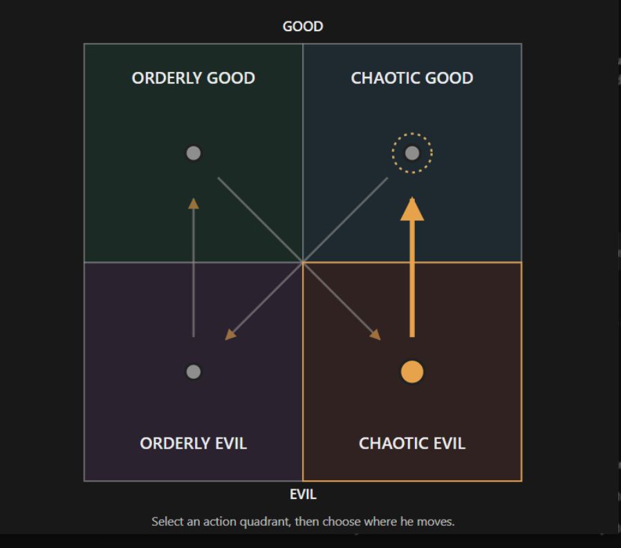

# The ESFJ failed merchant (unnamed; file is `esfj-m.md` until Rex names him)

Every field is marked **(Rex)**, **(proposed)** or **(open)**. Only (Rex) is canon. The field keys in backticks
follow `_TEMPLATE.md`.

- **Slot:** `esfj-m`
- **Status:** idea
- **Last changed:** 2026-10-27

## Identity

| Field | Key | Value | Mark |
|---|---|---|---|
| Name | `name` | | open |
| Type | `type` | ESFJ | Rex |
| Function stack | `stack` | Fe-Si-Ne-Ti | Rex |
| Gender | `gender` | man | Rex |
| Pirate archetype | `archetype` | a failed merchant | Rex |
| Ship job (posts held) | `posts` | | open |
| Where they are found | `found_at` | starting port / later port / at sea | open |
| Resident or visitor | `town_role` | resident, visitor, looking for work | open |

## The psycho

| Field | Key | Value | Mark |
|---|---|---|---|
| Psycho core | `psycho_core` | the type's killer form, in this character | open |
| Madness break | `madness_break` | what they do when the meter crosses the line | open |
| Madness triggers | `madness_triggers` | | open |
| Why piracy allows it | `permission` | how the setting makes it permissible | open |
| Their slight | `slight` | the thing that, repeated, makes them leave | open |
| Clues to the slight | `slight_clues` | obvious, subtle, too late | open |

## The person

| Field | Key | Value | Mark |
|---|---|---|---|
| Bio | `bio` | | open |
| Likes (gifts, acts) | `likes` | | open |
| Dislikes | `dislikes` | | open |
| Schedule | `schedule` | their day: post, meals, the den, sleep | open |
| Claims vs truth | `claims` | what they say they're good at, and whether it's true | open |

## Joining

| Field | Key | Value | Mark |
|---|---|---|---|
| How recruited | `recruit` | hire / mercenary / kidnap; what they need first (rep, proof, gift, questline) | open |
| What the town thinks of them | `town_view` | who likes them, who doesn't (kidnapping consequences) | open |

## Relationships

One row per other character Rex has tied them to. Affection, respect, rivalry, distrust, history.

| With | Key | What it is | Mark |
|---|---|---|---|
| the player | `rel.player` | | open |

## Heart events

| Hearts | Key | Scene | Mark |
|---|---|---|---|
| | `heart_events` | | open |

## Voice

| Field | Key | Value | Mark |
|---|---|---|---|
| Speech notes | `voice` | rhythm, vocabulary, what they never say | open |
| Keywords they answer | `keywords` | Morrowind-style topics, and what trust each needs | open |
| Sample lines | `lines` | Rex's lines only | open |

## Art notes (for the art keeper)

| Field | Key | Value | Mark |
|---|---|---|---|
| Look | `art.look` | based on the look of MrBeast (the YouTuber) | Rex |
| Signature face | `art.signature_face` | the one expression that is theirs | open |
| Heart-event scenes to illustrate | `art.scenes` | | open |

## Questline responses

How they react to what they witness you do on each of the four questlines (model and matrix:
`../QUESTLINES.md`; town system: `../../town/ENDINGS.md`; personality shifts: `../../STATS.md` §3). Rex,
2026-10-27: conduct on each path decides alignment, and crew who witness it move by their own inner rules.
Rex's rule: a character's nature isn't corrupted by the quest they go on.

| Questline | Key | Reaction to what they witness you do there | Mark |
|---|---|---|---|
| Orderly good (church-like) | `quest.order_good` | moves him to chaotic evil | Rex |
| Chaotic good (the stereotypical pirate town) | `quest.chaos_good` | moves him to orderly evil | Rex |
| Orderly evil (Cthulhu corruption) | `quest.order_evil` | moves him to orderly good | Rex |
| Chaotic evil (killers, devil worship) | `quest.chaos_evil` | moves him to chaotic good | Rex |

### Inner rules: his alignment map (Rex, 2026-10-27)

What the path you push him on does to his alignment (`../QUESTLINES.md`, model point 4). Rex's diagram:



```
              GOOD
   +-----------------+-----------------+
   |  ORDERLY GOOD   |  CHAOTIC GOOD   |
   |      (OG)       |      (CG)       |
   |       ^    \    |    /    ^       |
   +-------+-----\---+---/-----+-------+
   |       |      \  |  /      |       |
   |       |       \ | /       |       |
   |       |        \|/        |       |
   |       |        /|\        |       |
   |      (OE) <---' | '---> (CE)      |
   |  ORDERLY EVIL   |  CHAOTIC EVIL   |
   +-----------------+-----------------+
              EVIL
   OG->CE (diagonal)   CG->OE (diagonal)   OE->OG (up)   CE->CG (up)
```

| Pushed on (action quadrant) | He moves toward | Mark |
|---|---|---|
| Orderly good | chaotic evil | Rex |
| Chaotic good | orderly evil | Rex |
| Orderly evil | orderly good | Rex |
| Chaotic evil | chaotic good | Rex |

For the code (`inner_rules`, action → destination):
`{ "order_good": "chaos_evil", "chaos_good": "order_evil", "order_evil": "order_good", "chaos_evil": "chaos_good" }`

- No quadrant holds him: every action moves him somewhere else. The good quadrants send him diagonally to the
  opposite corner; the evil ones send him straight up to the good side of the same column.
- The dotted ring on chaotic good in the diagram marks the destination of the selected arrow, not "no change".
- **(open)** Starting alignment: none yet (Rex, 2026-10-27).

### His mentality: progressivism (Rex, 2026-10-27)

Why his map moves the way it does.

- **(Rex)** Orderly good → chaotic evil makes sense for him. Rex's example: America is orderly good, yet a
  liberal would defend a terrorist. Living inside an order he sees as broadly good, he fixes on its perceived
  injustices until he defends people who set out to destroy it.
- **(Rex)** Keep the arrows as they are.

**Proposed (outside AI, 2026-10-27; not canon):**

- The two upward responses (evil → good) fit his sympathy for people he sees as victims; the two downward ones
  (good → evil) fit his suspicion of apparently benevolent people and institutions.
- His central contradiction: so determined to challenge perceived injustice that he ends up supporting something
  worse. The turn is from "people deserve compassion" to "their suffering justifies whatever they do".
- Function reading: Fe identifies a group he believes suffers under the order; Si compares its treatment with how
  people ought to be treated; Ne imagines explanations that cast the condemned as victims; inferior Ti fails to
  reconcile the sympathy with what the group actually does.
- He doesn't see himself becoming evil; he believes he's correcting an injustice. The arrows show his real
  direction, not the label he gives himself.
- Still to explain: why he reacts differently to orderly good and chaotic good.

## Change log

| Date | Change | By |
|---|---|---|
| 2026-10-27 | Created: a failed merchant, his look based on MrBeast | Rex |
| 2026-10-27 | Inner rules: his alignment map (OG→CE, CG→OE, OE→OG, CE→CG); no starting point yet | Rex |
| 2026-10-27 | His mentality: progressivism; Rex's reasoning for OG→CE, with an outside AI's reading as proposals | Rex |
