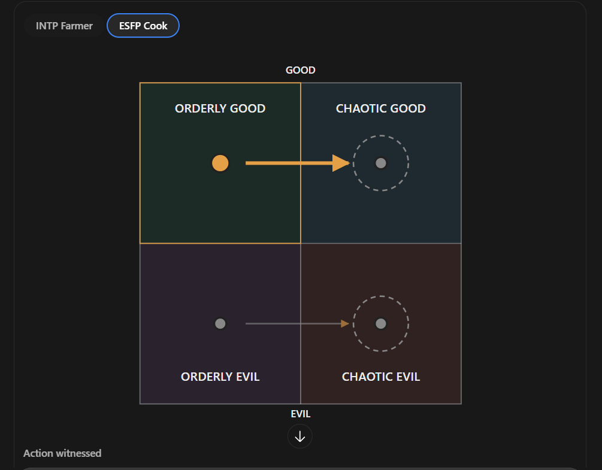

# The ESFP cook (unnamed; file is `esfp-f.md` until Rex names them, then it becomes `<slug>.md`)

Every field is marked **(Rex)**, **(proposed)** or **(open)**. Only (Rex) is canon. The field keys in backticks
follow `_TEMPLATE.md`.

- **Slot:** `esfp-f` (was `esfp-m` until 2026-10-27)
- **Status:** idea
- **Last changed:** 2026-10-27

## Identity

| Field | Key | Value | Mark |
|---|---|---|---|
| Name | `name` | | open |
| Type | `type` | ESFP | Rex |
| Function stack | `stack` | Se-Fi-Te-Ni | Rex |
| Gender | `gender` | woman (confirmed 2026-10-27; first notes had a man) | Rex |
| Pirate archetype | `archetype` | | open |
| Ship job (posts held) | `posts` | not really a baker, more of a general cook; has a butcher shop | Rex |
| Where they are found | `found_at` | the starting port: the bakery | Rex |
| Resident or visitor | `town_role` | resident | Rex |

## The psycho

| Field | Key | Value | Mark |
|---|---|---|---|
| Psycho core | `psycho_core` | jolly, with a dark side: secretly a cannibal, eating humans and using them in the food | Rex |
| Madness break | `madness_break` | what they do when the meter crosses the line | open |
| Madness triggers | `madness_triggers` | | open |
| Why piracy allows it | `permission` | how the setting makes it permissible | open |
| Their slight | `slight` | the thing that, repeated, makes them leave | open |
| Clues to the slight | `slight_clues` | obvious, subtle, too late | open |

## The person

| Field | Key | Value | Mark |
|---|---|---|---|
| Bio | `bio` | used to be married to the INTP farmer, who found out about the humans in the food when the farmer made perfectly good food from the farm's own crops; their son lives with the cook | Rex |
| Likes (gifts, acts) | `likes` | | open |
| Dislikes | `dislikes` | | open |
| Schedule | `schedule` | their day: post, meals, the den, sleep | open |
| Claims vs truth | `claims` | what they say they're good at, and whether it's true | open |

### The farm and the cook's shop: food-source consequences (Rex, 2026-10-27)

Shared with the other parent's file (`intp-m.md` / `esfp-f.md`); kept the same in both.

- **(Rex)** Three to four consequences, all about upgrading the town's food source.
- **(Rex)** Prerequisite quest for both: you provide them bodies. Later they decide to join you; you still give
  them bodies, and they send the bodies to their businesses so their next of kin keep everything going.
- **(Rex)** Whoever you take with you, their child takes charge of their business: the daughter runs the farm
  (the farmer's side), the son the cook's shop (the cook's side).
- **(Rex, tentative: "I think it would make sense")** The outcomes:
  - **Neither** (you take and help neither): that institution is overtaken by ghosts.
  - **One:** the one you take keeps getting more and more supply, which improves their station; it pushes the
    other one toward ghosthood.
  - **Both:** both improve, but a secret duel event happens (what it is, is open).
- **(open)** Rex wasn't sure at first whether the institution improves or declines, or what taking both does; the
  outcomes above are his answer as he thought it through.
- **(open)** "Both" is read as the farm and the cook's shop; "that institution" with neither is read as both
  businesses going to ghosts. To confirm.

## Joining

| Field | Key | Value | Mark |
|---|---|---|---|
| How recruited | `recruit` | requires higher reputation before they'll consider joining you, and you must complete sub quests for them; the prerequisite quest is providing them bodies (see the food-source consequences) | Rex |
| What the town thinks of them | `town_view` | who likes them, who doesn't (kidnapping consequences) | open |

## Relationships

One row per other character Rex has tied them to. Affection, respect, rivalry, distrust, history.

| With | Key | What it is | Mark |
|---|---|---|---|
| the player | `rel.player` | | open |
| the INTP farmer (`intp-m`) | `rel.intp-m` | ex-spouse; the farmer found out about the cannibalism | Rex |
| their son (`farm-son`) | `rel.farm-son` | lives with the cook, collects his victims' skins and enjoys bringing them to the butcher shop; the cook finds it a bit abhorrent: you shouldn't play with your food like that | Rex |
| their daughter (`farm-daughter`) | `rel.farm-daughter` | lives with the farmer | Rex |

## Heart events

| Hearts | Key | Scene | Mark |
|---|---|---|---|
| | `heart_events` | | open |

## Voice

| Field | Key | Value | Mark |
|---|---|---|---|
| Speech notes | `voice` | jolly | Rex |
| Keywords they answer | `keywords` | Morrowind-style topics, and what trust each needs | open |
| Sample lines | `lines` | Rex's lines only | open |

## Art notes (for the art keeper)

| Field | Key | Value | Mark |
|---|---|---|---|
| Look | `art.look` | build, face, hair, scars, outfit, colours | open |
| Signature face | `art.signature_face` | the one expression that is theirs | open |
| Heart-event scenes to illustrate | `art.scenes` | | open |

## Questline responses

How they react to what they witness you do on each of the four questlines (model and matrix:
`../QUESTLINES.md`; town system: `../../town/ENDINGS.md`; personality shifts: `../../STATS.md` §3). Rex,
2026-10-27: conduct on each path decides alignment, and crew who witness it move by their own inner rules.
Rex's rule: a character's nature isn't corrupted by the quest they go on.

| Questline | Key | Reaction to what they witness you do there | Mark |
|---|---|---|---|
| Orderly good (church-like) | `quest.order_good` | moves her to chaotic good | Rex |
| Chaotic good (the stereotypical pirate town) | `quest.chaos_good` | moves her to chaotic evil | Rex |
| Orderly evil (Cthulhu corruption) | `quest.order_evil` | moves her to chaotic evil | Rex |
| Chaotic evil (killers, devil worship) | `quest.chaos_evil` | no change: leans her toward chaotic evil | Rex |

- **(proposed, outside AI)** Paired developments: beloved provider vs hospitality as cover.

### Inner rules: her alignment map (Rex, 2026-10-27)

What the path you push her on does to her alignment (`../QUESTLINES.md`, model point 4). Rex's diagram:



```
              GOOD
   +-----------------+-----------------+
   |  ORDERLY GOOD   |  CHAOTIC GOOD   |
   |      (OG) ------+----> (CG)       |
   |                 |        |        |
   +-----------------+--------+--------+
   |                 |        v        |
   |      (OE) ------+----> (CE) ( )   |
   |  ORDERLY EVIL   |  CHAOTIC EVIL   |
   +-----------------+-----------------+
              EVIL
   OG->CG   CG->CE   OE->CE   CE no change
```

| Pushed on (action quadrant) | She moves toward | Mark |
|---|---|---|
| Orderly good | chaotic good | Rex |
| Chaotic good | chaotic evil | Rex |
| Orderly evil | chaotic evil | Rex |
| Chaotic evil | chaotic evil (no change: just leans that way) | Rex |

For the code (`inner_rules`, action → destination):
`{ "order_good": "chaos_good", "chaos_good": "chaos_evil", "order_evil": "chaos_evil", "chaos_evil": "chaos_evil" }`

- **(Rex)** The dashed ring means no change: if you commit that action, it just leans her in that direction.
- Every path ends in chaotic evil: orderly good passes through chaotic good on the way.
- **(open)** Starting alignment: to figure out later (the highlight on the diagram doesn't mark it).

## Change log

| Date | Change | By |
|---|---|---|
| 2026-10-27 | Created: the jolly baker who is secretly a cannibal | Rex |
| 2026-10-27 | Questline responses section added | keeper |
| 2026-10-27 | Questline cells reread as reactions to what they witness (was: taking them on a questline → effect) | Rex |
| 2026-10-27 | Not a baker but a general cook with a butcher shop; ex-spouse of the INTP farmer; parent of the son who collects skins; gender to confirm | Rex |
| 2026-10-27 | Gender confirmed: woman; file moved from `esfp-m.md` to `esfp-f.md` | Rex |
| 2026-10-27 | Joining: requires higher reputation, plus sub quests for them | Rex |
| 2026-10-27 | Inner rules: her alignment map (OG→CG, CG→CE, OE→CE, CE no change); replaces an earlier wrong chart sent the same day | Rex |
| 2026-10-27 | Food-source consequences: bodies as the prerequisite quest; their child runs the business; neither → ghosts, one → improves and the other toward ghosthood, both → both improve plus a secret duel | Rex |
