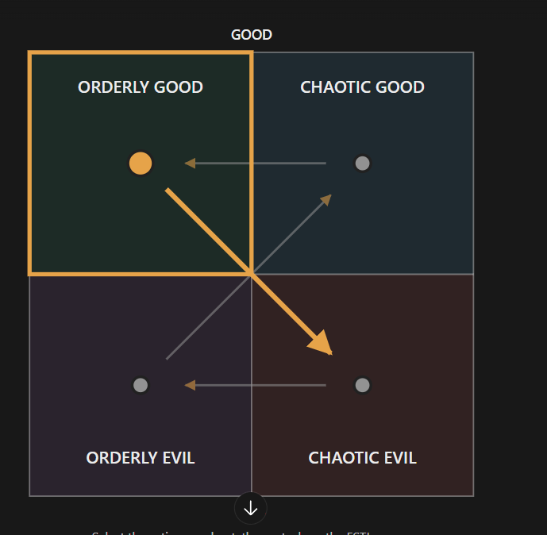

# The ESTJ privateer pirate (unnamed; file is `estj-f.md` until Rex names her)

Every field is marked **(Rex)**, **(proposed)** or **(open)**. Only (Rex) is canon. The field keys in backticks
follow `_TEMPLATE.md`.

- **Slot:** `estj-f` (file was `estj.md`, then `estj-m.md`, until 2026-10-27)
- **Status:** idea
- **Last changed:** 2026-10-27

## Identity

| Field | Key | Value | Mark |
|---|---|---|---|
| Name | `name` | | open |
| Type | `type` | ESTJ | Rex |
| Function stack | `stack` | Te-Si-Ne-Fi | Rex (type) |
| Gender | `gender` | woman, in her 40s (was a man earlier on 2026-10-27) | Rex |
| Pirate archetype | `archetype` | an old privateer pirate; a pirate lady | Rex |
| Ship job (posts held) | `posts` | competes with someone for control of the town hall (who is open: a character to come) | Rex |
| Where they are found | `found_at` | starting port / later port / at sea | open |
| Resident or visitor | `town_role` | resident, visitor, looking for work | open |

## The psycho

| Field | Key | Value | Mark |
|---|---|---|---|
| Psycho core | `psycho_core` | the type's killer form, in this character | open |
| Madness break | `madness_break` | what they do when the meter crosses the line | open |
| Madness triggers | `madness_triggers` | | open |
| Why piracy allows it | `permission` | how the setting makes it permissible | open |
| Their slight | `slight` | the thing that, repeated, makes them leave | open |
| Clues to the slight | `slight_clues` | obvious, subtle, too late | open |

## The person

| Field | Key | Value | Mark |
|---|---|---|---|
| Bio | `bio` | once part of a powerful crew, but she lost everyone (earlier the same day: "lost his crew at sea") | Rex |
| Likes (gifts, acts) | `likes` | | open |
| Dislikes | `dislikes` | | open |
| Schedule | `schedule` | their day: post, meals, the den, sleep | open |
| Claims vs truth | `claims` | what they say they're good at, and whether it's true | open |

## Joining

| Field | Key | Value | Mark |
|---|---|---|---|
| How recruited | `recruit` | after a sub quest: you prove your skill to her through a series of games she has you play at the pub. She then sees some potential in you and decides to join, to fix your messed-up boat and crew you up (which games is open) | Rex |
| What the town thinks of them | `town_view` | who likes them, who doesn't (kidnapping consequences) | open |

## Relationships

One row per other character Rex has tied them to. Affection, respect, rivalry, distrust, history.

| With | Key | What it is | Mark |
|---|---|---|---|
| the ENFP (`enfp.md`, tentative) | `rel.rival` | competes with her for control of the town hall; Rex is thinking an ENFP (tentative; gender open) | Rex (ENFP tentative) |
| the player | `rel.player` | tests you at the pub; sees some potential in you; joins to fix your boat and crew | Rex |

## Heart events

| Hearts | Key | Scene | Mark |
|---|---|---|---|
| | `heart_events` | | open |

## Voice

| Field | Key | Value | Mark |
|---|---|---|---|
| Speech notes | `voice` | rhythm, vocabulary, what they never say | open |
| Keywords they answer | `keywords` | Morrowind-style topics, and what trust each needs | open |
| Sample lines | `lines` | Rex's lines only | open |

## Art notes (for the art keeper)

| Field | Key | Value | Mark |
|---|---|---|---|
| Look | `art.look` | build, face, hair, scars, outfit, colours | open |
| Signature face | `art.signature_face` | the one expression that is theirs | open |
| Heart-event scenes to illustrate | `art.scenes` | | open |

## Questline responses

How they react to what they witness you do on each of the four questlines (model and matrix:
`../QUESTLINES.md`; town system: `../../town/ENDINGS.md`; personality shifts: `../../STATS.md` §3). Rex,
2026-10-27: conduct on each path decides alignment, and crew who witness it move by their own inner rules.
Rex's rule: a character's nature isn't corrupted by the quest they go on.

| Questline | Key | Reaction to what they witness you do there | Mark |
|---|---|---|---|
| Orderly good (church-like) | `quest.order_good` | moves them to chaotic evil | Rex |
| Chaotic good (the stereotypical pirate town) | `quest.chaos_good` | moves them to orderly good | Rex |
| Orderly evil (Cthulhu corruption) | `quest.order_evil` | moves them to chaotic good | Rex |
| Chaotic evil (killers, devil worship) | `quest.chaos_evil` | moves them to orderly evil | Rex |

### Inner rules: the alignment map (Rex, 2026-10-27)

What the path you push them on does to their alignment (`../QUESTLINES.md`, model point 4). Rex's diagram:



```
              GOOD
   +-----------------+-----------------+
   |  ORDERLY GOOD   |  CHAOTIC GOOD   |
   |      (OG) <-----+----- (CG)       |
   |         \       |    ^            |
   |          \      |   /             |
   +-----------\-----+--/--------------+
   |            \    | /               |
   |      (OE)   \---+/---> (CE)       |
   |       ^---------+------'          |
   |  ORDERLY EVIL   |  CHAOTIC EVIL   |
   +-----------------+-----------------+
              EVIL
   OG->CE   CG->OG   OE->CG   CE->OE
```

| Pushed on (action quadrant) | They move toward | Mark |
|---|---|---|
| Orderly good | chaotic evil | Rex |
| Chaotic good | orderly good | Rex |
| Orderly evil | chaotic good | Rex |
| Chaotic evil | orderly evil | Rex |

For the code (`inner_rules`, action → destination):
`{ "order_good": "chaos_evil", "chaos_good": "order_good", "order_evil": "chaos_good", "chaos_evil": "order_evil" }`

- **(open)** Their natural alignment. Unlike the ENTP's map, no quadrant loops back to itself.

- **(Rex, 2026-10-28, for now)** Starting alignment: orderly evil. Starting position and chart are independent (`../../balance/ALIGNMENT.md`).

## Change log

| Date | Change | By |
|---|---|---|
| 2026-10-27 | Created with the alignment map (OG→CE, CG→OG, OE→CG, CE→OE) | Rex |
| 2026-10-27 | An old privateer who lost his crew at sea; a man; file moved from `estj.md` to `estj-m.md` | Rex |
| 2026-10-27 | Now a woman: a pirate lady in her 40s, once part of a powerful crew, who lost everyone; file moved from `estj-m.md` to `estj-f.md` | Rex |
| 2026-10-27 | Why she joins: after you prove your skill in a series of pub games, she sees potential and joins to fix your boat and crew | Rex |
| 2026-10-28 | Competes with someone (to come) for control of the town hall | Rex |
| 2026-10-28 | Her town hall rival: Rex is thinking an ENFP (tentative) | Rex |
| 2026-10-28 | Starting alignment for now: orderly evil | Rex |
