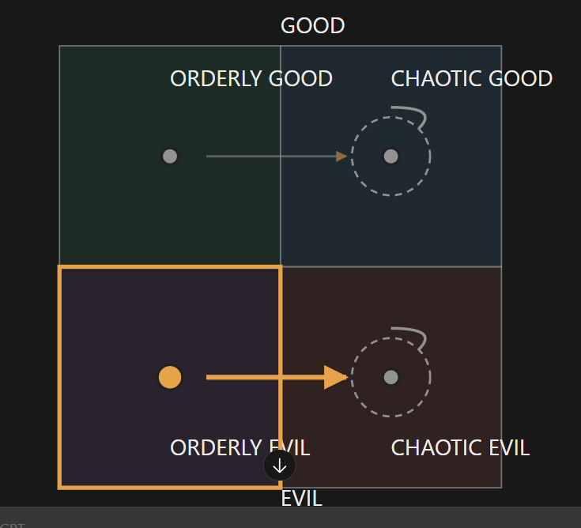

# The ESTP veteran outdoorswoman (unnamed; file is `estp-f.md` until Rex names them, then it becomes `<slug>.md`)

Every field is marked **(Rex)**, **(proposed)** or **(open)**. Only (Rex) is canon. The field keys in backticks
follow `_TEMPLATE.md`.

- **Slot:** `estp-f` (was `estp-m` until 2026-10-27)
- **Status:** idea
- **Last changed:** 2026-10-27

## Identity

| Field | Key | Value | Mark |
|---|---|---|---|
| Name | `name` | | open |
| Type | `type` | ESTP | Rex |
| Function stack | `stack` | Se-Ti-Fe-Ni | Rex |
| Gender | `gender` | woman: brutish and butch (was a man until 2026-10-27) | Rex |
| Pirate archetype | `archetype` | a veteran (was "an old soldier"), now an outdoorsman: a wilderness generalist who gathers wood, stone, herbs and food. The ISTP specialises in hunting only; she does a bit of everything | Rex |
| Ship job (posts held) | `posts` | the starting port's secret cook: she doesn't seem to know how to cook, but she is the best cook there | Rex |
| Where they are found | `found_at` | the only constant way to find her is at the old coastal fort on a certain day of the week. She lives in an isolated hut away from town and goes into the forest. Earlier: a locked house in town you can't access (whether it still exists is open) | Rex; locked house open |
| Resident or visitor | `town_role` | lives apart from town, in her hut | Rex |

## The psycho

| Field | Key | Value | Mark |
|---|---|---|---|
| Psycho core | `psycho_core` | old, very strong, and a killer | Rex |
| Madness break | `madness_break` | what they do when the meter crosses the line | open |
| Madness triggers | `madness_triggers` | | open |
| Why piracy allows it | `permission` | how the setting makes it permissible | open |
| Their slight | `slight` | the thing that, repeated, makes them leave | open |
| Clues to the slight | `slight_clues` | obvious, subtle, too late | open |

## The person

| Field | Key | Value | Mark |
|---|---|---|---|
| Bio | `bio` | a veteran who lives isolated in a hut and is rarely seen, explained by her gathering everything she needs on her own | Rex |
| Likes (gifts, acts) | `likes` | | open |
| Dislikes | `dislikes` | | open |
| Schedule | `schedule` | at the old coastal fort on a certain day each week (the one constant place to find her); otherwise gathering in the wild, in the forest, or at her hut; rarely seen | Rex |
| Claims vs truth | `claims` | doesn't seem to be a cook; is the best one in town | Rex |

### Notes (Rex, 2026-10-27)

- **(Rex)** Her whole thing: she lives isolated in a hut away from town and is rarely seen, because she gathers everything she needs on her own.
- **(Rex)** The weekly fort day holds: it is the only constant way to find her.
- **(open)** Whether the locked house in town still exists alongside the hut.
- **(open)** Whether she is still the secret cook who looks like your first mate.
- **(open)** What she does at the fort.
- **(Rex, 2026-10-27)** She is the secret cook: the ESTP who very clearly looks like your first mate (`../../PIRATE.md` §7b).

## Joining

| Field | Key | Value | Mark |
|---|---|---|---|
| How recruited | `recruit` | a secret character; whether and how she joins is open | Rex (secret); rest open |
| What the town thinks of them | `town_view` | who likes them, who doesn't (kidnapping consequences) | open |

## Relationships

One row per other character Rex has tied them to. Affection, respect, rivalry, distrust, history.

| With | Key | What it is | Mark |
|---|---|---|---|
| the player | `rel.player` | | open |

## Heart events

| Hearts | Key | Scene | Mark |
|---|---|---|---|
| | `heart_events` | | open |

## Voice

| Field | Key | Value | Mark |
|---|---|---|---|
| Speech notes | `voice` | rhythm, vocabulary, what they never say | open |
| Keywords they answer | `keywords` | Morrowind-style topics, and what trust each needs | open |
| Sample lines | `lines` | Rex's lines only | open |

## Art notes (for the art keeper)

| Field | Key | Value | Mark |
|---|---|---|---|
| Look | `art.look` | a brutish, butch woman; she very clearly looks like your first mate (`../../PIRATE.md` §7b) | Rex |
| Signature face | `art.signature_face` | the one expression that is theirs | open |
| Heart-event scenes to illustrate | `art.scenes` | | open |

## Questline responses

How they react to what they witness you do on each of the four questlines (model and matrix:
`../QUESTLINES.md`; town system: `../../town/ENDINGS.md`; personality shifts: `../../STATS.md` §3). Rex,
2026-10-27: conduct on each path decides alignment, and crew who witness it move by their own inner rules.
Rex's rule: a character's nature isn't corrupted by the quest they go on.

| Questline | Key | Reaction to what they witness you do there | Mark |
|---|---|---|---|
| Orderly good (church-like) | `quest.order_good` | moves her to chaotic good | Rex |
| Chaotic good (the stereotypical pirate town) | `quest.chaos_good` | stays chaotic good (loop) | Rex |
| Orderly evil (Cthulhu corruption) | `quest.order_evil` | moves her to chaotic evil | Rex |
| Chaotic evil (killers, devil worship) | `quest.chaos_evil` | stays chaotic evil (loop) | Rex |

### Inner rules: her alignment map (Rex, 2026-10-27)

What the path you push her on does to her alignment (`../QUESTLINES.md`, model point 4). Rex's diagram:



```
              GOOD
   +-----------------+-----------------+
   |  ORDERLY GOOD   |  CHAOTIC GOOD   |
   |      (OG) ------+----> (CG) <-+   |
   |                 |          \_/    |
   +-----------------+-----------------+
   |      (OE) ------+----> (CE) <-+   |
   |                 |          \_/    |
   |  ORDERLY EVIL   |  CHAOTIC EVIL   |
   +-----------------+-----------------+
              EVIL
   OG->CG   CG stays   OE->CE   CE stays
```

| Pushed on (action quadrant) | She moves toward | Mark |
|---|---|---|
| Orderly good | chaotic good | Rex |
| Chaotic good | chaotic good (stays: a loop) | Rex |
| Orderly evil | chaotic evil | Rex |
| Chaotic evil | chaotic evil (stays: a loop) | Rex |

For the code (`inner_rules`, action → destination):
`{ "order_good": "chaos_good", "chaos_good": "chaos_good", "order_evil": "chaos_evil", "chaos_evil": "chaos_evil" }`

- Everything pulls her toward chaos, and the good/evil side follows what you do (the mirror of the ENFJ's map,
  which pulls toward order).
- **(Rex, 2026-10-27)** The highlight on orderly evil doesn't mark her starting alignment.
- **(open)** Her starting alignment: to figure out later.

## Change log

| Date | Change | By |
|---|---|---|
| 2026-10-27 | Created: a secret character: an old soldier who walks to the old coastal fort once a week | Rex |
| 2026-10-27 | He is the secret cook who looks like your first mate | Rex |
| 2026-10-27 | Questline responses section added | keeper |
| 2026-10-27 | Questline cells reread as reactions to what they witness (was: taking them on a questline → effect) | Rex |
| 2026-10-27 | Now a woman: brutish and butch; file moved from `estp-m.md` to `estp-f.md` | Rex |
| 2026-10-27 | A veteran turned outdoorsman: a wilderness generalist (wood, stone, herbs, food), unlike the ISTP's hunting; lives isolated in a hut away from town, rarely seen | Rex |
| 2026-10-27 | The fort day holds: the only constant way to find her; she lives in the hut and goes into the forest | Rex |
| 2026-10-27 | Confirmed: she goes into the forest | Rex |
| 2026-10-27 | Inner rules: her alignment map (OG→CG, CG stays, OE→CE, CE stays) | Rex |
| 2026-10-27 | The diagram's highlight isn't her starting alignment; starting alignment left for later | Rex |
