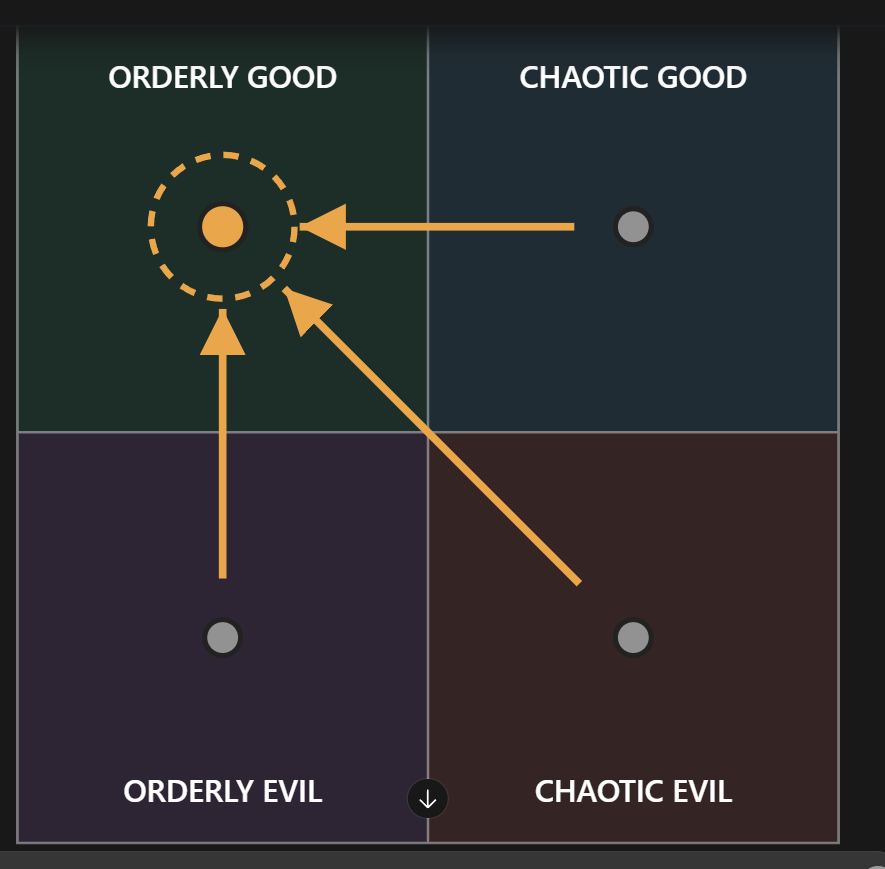

# The INFJ mechanic (unnamed; file is `infj-m.md` until Rex names him)

Every field is marked **(Rex)**, **(proposed)** or **(open)**. Only (Rex) is canon. The field keys in backticks
follow `_TEMPLATE.md`.

- **Slot:** `infj-m`
- **Status:** idea
- **Last changed:** 2026-10-28

## Identity

| Field | Key | Value | Mark |
|---|---|---|---|
| Name | `name` | | open |
| Type | `type` | INFJ | Rex |
| Function stack | `stack` | Ni-Fe-Ti-Se | Rex |
| Gender | `gender` | man | Rex |
| Pirate archetype | `archetype` | a mechanic, an inventor | Rex |
| Ship job (posts held) | `posts` | an inventor of machinery; has done this his whole life | Rex |
| Where they are found | `found_at` | starting port / later port / at sea | open |
| Resident or visitor | `town_role` | a newcomer to town; getting ready to leave soon | Rex |

## The psycho

| Field | Key | Value | Mark |
|---|---|---|---|
| Psycho core | `psycho_core` | the type's killer form, in this character | open |
| Madness break | `madness_break` | what they do when the meter crosses the line | open |
| Madness triggers | `madness_triggers` | | open |
| Why piracy allows it | `permission` | how the setting makes it permissible | open |
| Their slight | `slight` | the thing that, repeated, makes them leave | open |
| Clues to the slight | `slight_clues` | obvious, subtle, too late | open |

## The person

| Field | Key | Value | Mark |
|---|---|---|---|
| Bio | `bio` | a newcomer to town whose inventions are blowing the ENTP out of the water. He is clearly dominating but not trying hard: he's really just trying to get in so he can start being lazy, milk everyone for their money, then dip out when they can't provide any more. He's getting ready to leave soon because the town is nearly out of cash; he has only stayed so long because of nostalgia, and someone has invited him to the next town over to be part of their big project | Rex |
| Likes (gifts, acts) | `likes` | | open |
| Dislikes | `dislikes` | | open |
| Schedule | `schedule` | their day: post, meals, the den, sleep | open |
| Claims vs truth | `claims` | what they say they're good at, and whether it's true | open |

## Joining

| Field | Key | Value | Mark |
|---|---|---|---|
| How recruited | `recruit` | hire / mercenary / kidnap; what they need first (rep, proof, gift, questline) | open |
| What the town thinks of them | `town_view` | who likes them, who doesn't (kidnapping consequences) | open |
| What develops their place | `develops_place` | recruiting alone doesn't develop it: a sub quest or supplying what they need (which is open) | open |

## Relationships

One row per other character Rex has tied them to. Affection, respect, rivalry, distrust, history.

| With | Key | What it is | Mark |
|---|---|---|---|
| the player | `rel.player` | | open |
| the ENTP mechanic (`entp-m`) | `rel.entp-m` | rivals: the INFJ has spent his whole life doing this, the ENTP only started two years ago. The INFJ makes more consistently effective machinery; the ENTP's weapons have more devastating potential if he can work out the bugs | Rex |

## Heart events

| Hearts | Key | Scene | Mark |
|---|---|---|---|
| | `heart_events` | | open |

## Voice

| Field | Key | Value | Mark |
|---|---|---|---|
| Speech notes | `voice` | rhythm, vocabulary, what they never say | open |
| Keywords they answer | `keywords` | Morrowind-style topics, and what trust each needs | open |
| Sample lines | `lines` | Rex's lines only | open |

## Art notes (for the art keeper)

| Field | Key | Value | Mark |
|---|---|---|---|
| Look | `art.look` | build, face, hair, scars, outfit, colours | open |
| Signature face | `art.signature_face` | the one expression that is theirs | open |
| Heart-event scenes to illustrate | `art.scenes` | | open |

## Questline responses

How they react to what they witness you do on each of the four questlines (model and matrix:
`../QUESTLINES.md`; town system: `../../town/ENDINGS.md`; personality shifts: `../../STATS.md` §3). Rex,
2026-10-27: conduct on each path decides alignment, and crew who witness it move by their own inner rules.
Rex's rule: a character's nature isn't corrupted by the quest they go on.

| Questline | Key | Reaction to what they witness you do there | Mark |
|---|---|---|---|
| Orderly good (church-like) | `quest.order_good` | leans him toward orderly good; kept up, the lean carries him all the way into it | Rex |
| Chaotic good (the stereotypical pirate town) | `quest.chaos_good` | moves him to orderly good | Rex |
| Orderly evil (Cthulhu corruption) | `quest.order_evil` | moves him to orderly good | Rex |
| Chaotic evil (killers, devil worship) | `quest.chaos_evil` | moves him to orderly good | Rex |

### Notes (Rex, 2026-10-28)

- **(open)** What his nostalgia for the town is (a past tie to it?).
- **(open)** Who in the next town over invited him, and what their big project is.
- **(open)** Where he lives and works in town; whether he is recruitable or romanceable (until Rex says, he is not counted among the 12).

### Inner rules: his alignment map (Rex, 2026-10-28)

What the path you push him on does to his alignment (`../QUESTLINES.md`, model point 4). Rex's diagram:



```
              GOOD
   +-----------------+-----------------+
   |  ORDERLY GOOD   |  CHAOTIC GOOD   |
   |   ( (OG) ) <----+------ (CG)      |
   |      ^   ^      |                 |
   +------|----\-----+-----------------+
   |      |     \    |                 |
   |     (OE)    \---+------ (CE)      |
   |  ORDERLY EVIL   |  CHAOTIC EVIL   |
   +-----------------+-----------------+
              EVIL
   OG lean   CG->OG   OE->OG   CE->OG
```

| Pushed on (action quadrant) | He moves toward | Mark |
|---|---|---|
| Orderly good | orderly good (a lean: kept up, it carries him all the way there) | Rex |
| Chaotic good | orderly good | Rex |
| Orderly evil | orderly good | Rex |
| Chaotic evil | orderly good | Rex |

For the code (`inner_rules`, action → destination):
`{ "order_good": "order_good", "chaos_good": "order_good", "order_evil": "order_good", "chaos_evil": "order_good" }`

- **(Rex)** Dashed ring: committing that action leans him that way; kept up, the lean carries him all the way into that quadrant.
- Every path ends in orderly good: the INTJ's all-roads-to-orderly-evil shape, mirrored onto orderly good.
- **(Rex, 2026-10-28, for now)** Starting alignment: orderly good. Starting position and chart are independent (`../../balance/ALIGNMENT.md`).

## Change log

| Date | Change | By |
|---|---|---|
| 2026-10-28 | Created: a newcomer mechanic whose inventions outclass the ENTP's; milking the town for money before leaving for a big project in the next town over | Rex |
| 2026-10-28 | Inner rules: his alignment map (OG lean, CG→OG, OE→OG, CE→OG): every path ends in orderly good | Rex |
| 2026-10-28 | Starting alignment for now: orderly good | Rex |
| 2026-10-28 | New field `develops_place`: recruiting alone doesn't develop their place; it takes a sub quest or supplying what they need | Rex |
