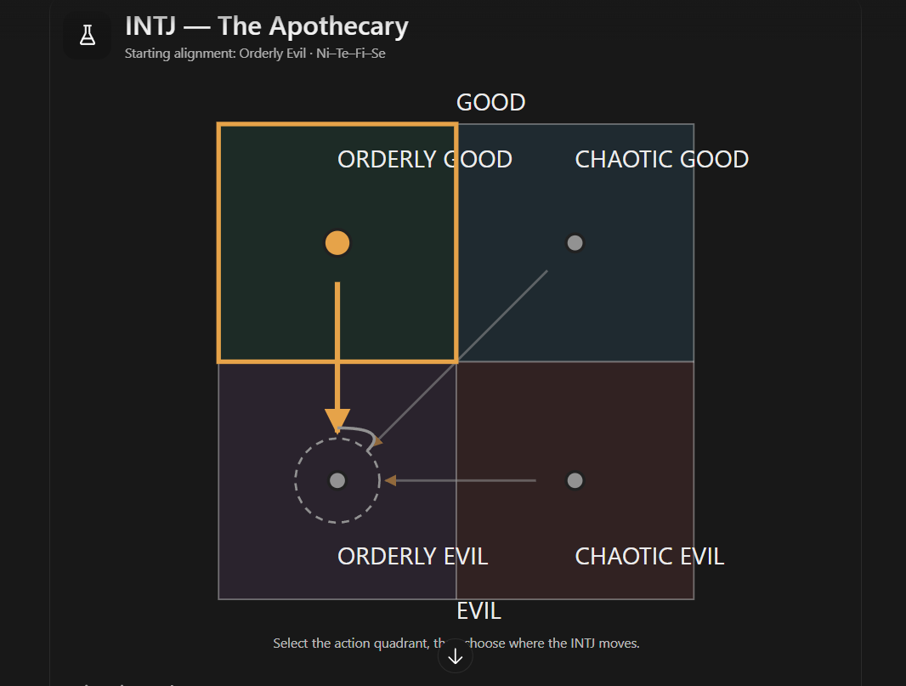

# The INTJ apothecary (unnamed; file is `intj-f.md` until Rex names them, then it becomes `<slug>.md`)

Every field is marked **(Rex)**, **(proposed)** or **(open)**. Only (Rex) is canon. The field keys in backticks
follow `_TEMPLATE.md`.

- **Slot:** `intj-f`
- **Status:** idea
- **Last changed:** 2026-10-27

## Identity

| Field | Key | Value | Mark |
|---|---|---|---|
| Name | `name` | | open |
| Type | `type` | INTJ | Rex |
| Function stack | `stack` | Ni-Te-Fi-Se | Rex |
| Gender | `gender` | woman | Rex |
| Pirate archetype | `archetype` | herbalist | Rex |
| Ship job (posts held) | `posts` | herbalist; owns the apothecary in town, concocting potions, tinctures and such | Rex |
| Where they are found | `found_at` | the starting port: the apothecary | Rex |
| Resident or visitor | `town_role` | resident | Rex |

## The psycho

| Field | Key | Value | Mark |
|---|---|---|---|
| Psycho core | `psycho_core` | she believes in testing her concoctions on evil people, and has no qualms if a bad person tests her potions | Rex |
| Madness break | `madness_break` | what they do when the meter crosses the line | open |
| Madness triggers | `madness_triggers` | | open |
| Why piracy allows it | `permission` | how the setting makes it permissible | open |
| Their slight | `slight` | the thing that, repeated, makes them leave | open |
| Clues to the slight | `slight_clues` | obvious, subtle, too late | open |

## The person

| Field | Key | Value | Mark |
|---|---|---|---|
| Bio | `bio` | the daughter of the apothecary's previous owner; a bit unconventional | Rex |
| Likes (gifts, acts) | `likes` | | open |
| Dislikes | `dislikes` | | open |
| Schedule | `schedule` | their day: post, meals, the den, sleep | open |
| Claims vs truth | `claims` | what they say they're good at, and whether it's true | open |

### Notes (Rex, 2026-10-27)

- **(Rex) Her questline is essentially a gamble.** She tests potions on evil people, or on people she perceives as evil.
- **(Rex)** Your job is to determine whether what she's made will kill the person, and whether they deserve it. It is based mostly on science and the clues you receive.
- **(Rex)** Your job is to navigate her psychopathy to help her recover.
- **(Rex)** People she gives potions to who don't deserve it can't die; she needs to discover naturally that they are innocent, or not evil.
- **(Rex, 2026-10-27)** She is the daughter of the apothecary's previous owner.

## Joining

| Field | Key | Value | Mark |
|---|---|---|---|
| How recruited | `recruit` | her questline (below) | Rex |
| What the town thinks of them | `town_view` | who likes them, who doesn't (kidnapping consequences) | open |

## Relationships

One row per other character Rex has tied them to. Affection, respect, rivalry, distrust, history.

| With | Key | What it is | Mark |
|---|---|---|---|
| the player | `rel.player` | | open |

## Heart events

| Hearts | Key | Scene | Mark |
|---|---|---|---|
| | `heart_events` | | open |

## Voice

| Field | Key | Value | Mark |
|---|---|---|---|
| Speech notes | `voice` | rhythm, vocabulary, what they never say | open |
| Keywords they answer | `keywords` | Morrowind-style topics, and what trust each needs | open |
| Sample lines | `lines` | Rex's lines only | open |

## Art notes (for the art keeper)

| Field | Key | Value | Mark |
|---|---|---|---|
| Look | `art.look` | build, face, hair, scars, outfit, colours | open |
| Signature face | `art.signature_face` | the one expression that is theirs | open |
| Heart-event scenes to illustrate | `art.scenes` | | open |

## Questline responses

How they react to what they witness you do on each of the four questlines (model and matrix:
`../QUESTLINES.md`; town system: `../../town/ENDINGS.md`; personality shifts: `../../STATS.md` §3). Rex,
2026-10-27: conduct on each path decides alignment, and crew who witness it move by their own inner rules.
Rex's rule: a character's nature isn't corrupted by the quest they go on.

| Questline | Key | Reaction to what they witness you do there | Mark |
|---|---|---|---|
| Orderly good (church-like) | `quest.order_good` | moves her to orderly evil | Rex |
| Chaotic good (the stereotypical pirate town) | `quest.chaos_good` | moves her to orderly evil | Rex |
| Orderly evil (Cthulhu corruption) | `quest.order_evil` | stays orderly evil (loop) | Rex |
| Chaotic evil (killers, devil worship) | `quest.chaos_evil` | moves her to orderly evil | Rex |

- **(proposed, outside AI)** Paired developments: ethical research vs prisoner experiments.

### Inner rules: her alignment map (Rex, 2026-10-27)

What the path you push her on does to her alignment (`../QUESTLINES.md`, model point 4). Rex's diagram:



Every arrow ends in orderly evil:

```
              GOOD
   +-----------------+-----------------+
   |  ORDERLY GOOD   |  CHAOTIC GOOD   |
   |      (OG)       |      (CG)       |
   |       |         |     /           |
   +-------+---------+----/------------+
   |       v         |   /             |
   |      (OE) <-----+--'---- (CE)     |
   |      loop       |                 |
   |  ORDERLY EVIL   |  CHAOTIC EVIL   |
   +-----------------+-----------------+
              EVIL
   OG->OE   CG->OE   OE stays   CE->OE
```

| Pushed on (action quadrant) | She moves toward | Mark |
|---|---|---|
| Orderly good | orderly evil | Rex |
| Chaotic good | orderly evil | Rex |
| Orderly evil | orderly evil (stays: the loop) | Rex |
| Chaotic evil | orderly evil | Rex |

For the code (`inner_rules`, action → destination):
`{ "order_good": "order_evil", "chaos_good": "order_evil", "order_evil": "order_evil", "chaos_evil": "order_evil" }`

- **(Rex)** "I feel like how I designed the INTJ alignment is very INTJ."
- **(Rex)** Starting alignment: orderly evil (on his diagram).
- **(Rex, 2026-10-27) The one way out:** her only path is toward orderly evil, unless you show her that her
  belief is wrong; then she becomes neutral.
- **(open)** What shows her she's wrong (her questline's innocent victim is the outside AI's proposal), and what
  "neutral" means on the square (the centre? a new map?).

**Proposed (outside AI, 2026-10-27; not canon):**

- What she sees in each: orderly good protecting people she judges dangerous (moral limits block necessary
  progress); chaotic good as freedom without accountability (people can't govern themselves, so: control); orderly
  evil as authority that enables systematic experiment (confirmation); chaotic evil as wasteful, unscientific
  cruelty (suffering should serve a purpose).
- The function reading: Ni keeps the vision constant and fits new things into it; Te turns everything into
  supporting evidence; Fi makes her private moral verdicts feel objective; inferior Se is where reality finally
  forces a confrontation.
- Her map explains why she doesn't change, where the others' explain how they do. She isn't immune, only resistant
  to ordinary influence.
- An exceptional transformation condition tied to her questline: discovering through her own investigation that
  someone she experimented on was innocent breaks her premise that she can tell who deserves it, and could unlock
  a different map or a path toward orderly good.
- If every character is meant to reach all four alignments through ordinary play, this map prevents it for her.

## Change log

| Date | Change | By |
|---|---|---|
| 2026-10-27 | Created: the herbalist who tests her potions on people she judges evil | Rex |
| 2026-10-27 | Daughter of the apothecary's previous owner | Rex |
| 2026-10-27 | Questline responses section added | keeper |
| 2026-10-27 | Questline cells reread as reactions to what they witness (was: taking them on a questline → effect) | Rex |
| 2026-10-27 | Inner rules: her alignment map, every path leads to orderly evil | Rex |
| 2026-10-27 | Diagram image saved; starting alignment orderly evil | Rex |
| 2026-10-27 | Only path is orderly evil unless shown her belief is wrong; then she becomes neutral | Rex |
