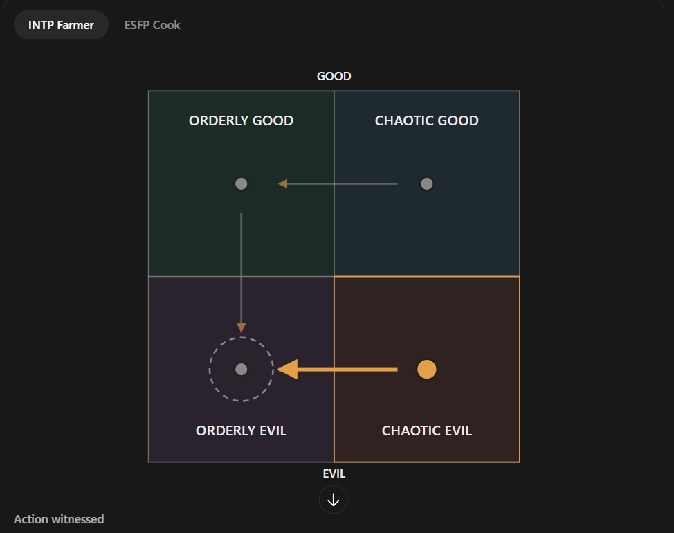

# The INTP farmer (unnamed; file is `intp-m.md` until Rex names them, then it becomes `<slug>.md`)

Every field is marked **(Rex)**, **(proposed)** or **(open)**. Only (Rex) is canon. The field keys in backticks
follow `_TEMPLATE.md`.

- **Slot:** `intp-m` (was `intp-f` until 2026-10-27)
- **Status:** idea
- **Last changed:** 2026-10-27

## Identity

| Field | Key | Value | Mark |
|---|---|---|---|
| Name | `name` | | open |
| Type | `type` | INTP | Rex |
| Function stack | `stack` | Ti-Ne-Si-Fe | Rex |
| Gender | `gender` | man (confirmed 2026-10-27; first notes had a woman) | Rex |
| Pirate archetype | `archetype` | | open |
| Ship job (posts held) | `posts` | farmer: runs the farm in town | Rex |
| Where they are found | `found_at` | the starting port: the farm | Rex |
| Resident or visitor | `town_role` | resident | Rex |

## The psycho

| Field | Key | Value | Mark |
|---|---|---|---|
| Psycho core | `psycho_core` | secretly uses dead, decomposing bodies as fertiliser and has been known to kill passers-by for it; the longer the crops go without a body, the more determined the farmer becomes to find one | Rex |
| Madness break | `madness_break` | what they do when the meter crosses the line | open |
| Madness triggers | `madness_triggers` | | open |
| Why piracy allows it | `permission` | how the setting makes it permissible | open |
| Their slight | `slight` | the thing that, repeated, makes them leave | open |
| Clues to the slight | `slight_clues` | obvious, subtle, too late | open |

## The person

| Field | Key | Value | Mark |
|---|---|---|---|
| Bio | `bio` | used to be married to the ESFP cook; found out about the cook eating humans and using them in the food, when the farmer made perfectly good food from the farm's own crops. Their daughter helps run the farm. (Supersedes "the spouse died") | Rex |
| Likes (gifts, acts) | `likes` | | open |
| Dislikes | `dislikes` | | open |
| Schedule | `schedule` | their day: post, meals, the den, sleep | open |
| Claims vs truth | `claims` | what they say they're good at, and whether it's true | open |

### Notes (Rex, 2026-10-27)

- **(Rex)** Based on April Ludgate from Parks and Recreation (Aubrey Plaza), the deadpan one.
- ~~**(open)** What her psychopathy is.~~ Answered 2026-10-27: bodies as fertiliser (see Psycho core).

### The farm and the cook's shop: food-source consequences (Rex, 2026-10-27)

Shared with the other parent's file (`intp-m.md` / `esfp-f.md`); kept the same in both.

- **(Rex)** Three to four consequences, all about upgrading the town's food source.
- **(Rex)** Prerequisite quest for both: you provide them bodies. Later they decide to join you; you still give
  them bodies, and they send the bodies to their businesses so their next of kin keep everything going.
- **(Rex)** Whoever you take with you, their child takes charge of their business: the daughter runs the farm
  (the farmer's side), the son the cook's shop (the cook's side).
- **(Rex, tentative: "I think it would make sense")** The outcomes:
  - **Neither** (you take and help neither): that institution is overtaken by ghosts.
  - **One:** the one you take keeps getting more and more supply, which improves their station; it pushes the
    other one toward ghosthood.
  - **Both:** both improve, but a secret duel event happens (what it is, is open).
- **(open)** Rex wasn't sure at first whether the institution improves or declines, or what taking both does; the
  outcomes above are his answer as he thought it through.
- **(Rex, 2026-10-27)** Confirmed: taking neither sends both the farm and the cook's shop to ghosts.

## Joining

| Field | Key | Value | Mark |
|---|---|---|---|
| How recruited | `recruit` | requires higher reputation before they'll consider joining you, and you must complete sub quests for them; the prerequisite quest is providing them bodies (see the food-source consequences). Why they join (Rex): they simply want to see the world more and need a break from the island; since you've been helping them, they decide it's no big deal, as long as they can still come back and use more dead bodies (the farmer's and cook's reasons are similar for now; Rex will make them distinct later) | Rex |
| What the town thinks of them | `town_view` | who likes them, who doesn't (kidnapping consequences) | open |

## Relationships

One row per other character Rex has tied them to. Affection, respect, rivalry, distrust, history.

| With | Key | What it is | Mark |
|---|---|---|---|
| the player | `rel.player` | | open |
| the ESFP cook (`esfp-f`) | `rel.esfp-f` | ex-spouse; the farmer found out about the cannibalism | Rex |
| their daughter (`farm-daughter`) | `rel.farm-daughter` | helps run the farm | Rex |
| their son (`farm-son`) | `rel.farm-son` | lives with the cook | Rex |

## Heart events

| Hearts | Key | Scene | Mark |
|---|---|---|---|
| | `heart_events` | | open |

## Voice

| Field | Key | Value | Mark |
|---|---|---|---|
| Speech notes | `voice` | deadpan | Rex |
| Keywords they answer | `keywords` | Morrowind-style topics, and what trust each needs | open |
| Sample lines | `lines` | Rex's lines only | open |

## Art notes (for the art keeper)

| Field | Key | Value | Mark |
|---|---|---|---|
| Look | `art.look` | based on April Ludgate (Aubrey Plaza's deadpan character in Parks and Recreation); open whether this still applies now the farmer is a man | Rex |
| Signature face | `art.signature_face` | the one expression that is theirs | open |
| Heart-event scenes to illustrate | `art.scenes` | | open |

## Questline responses

How they react to what they witness you do on each of the four questlines (model and matrix:
`../QUESTLINES.md`; town system: `../../town/ENDINGS.md`; personality shifts: `../../STATS.md` §3). Rex,
2026-10-27: conduct on each path decides alignment, and crew who witness it move by their own inner rules.
Rex's rule: a character's nature isn't corrupted by the quest they go on.

| Questline | Key | Reaction to what they witness you do there | Mark |
|---|---|---|---|
| Orderly good (church-like) | `quest.order_good` | moves him to orderly evil | Rex |
| Chaotic good (the stereotypical pirate town) | `quest.chaos_good` | moves him to orderly good | Rex |
| Orderly evil (Cthulhu corruption) | `quest.order_evil` | leans him toward orderly evil; kept up, the lean carries him all the way into it | Rex |
| Chaotic evil (killers, devil worship) | `quest.chaos_evil` | moves him to orderly evil | Rex |

### Inner rules: his alignment map (Rex, 2026-10-27)

What the path you push him on does to his alignment (`../QUESTLINES.md`, model point 4). Rex's diagram:



```
              GOOD
   +-----------------+-----------------+
   |  ORDERLY GOOD   |  CHAOTIC GOOD   |
   |      (OG) <-----+------ (CG)      |
   |       |         |                 |
   +-------+---------+-----------------+
   |       v         |                 |
   |  ( ) (OE) <-----+------ (CE)      |
   |  ORDERLY EVIL   |  CHAOTIC EVIL   |
   +-----------------+-----------------+
              EVIL
   OG->OE   CG->OG   OE lean   CE->OE
```

| Pushed on (action quadrant) | He moves toward | Mark |
|---|---|---|
| Orderly good | orderly evil | Rex |
| Chaotic good | orderly good | Rex |
| Orderly evil | orderly evil (a lean: kept up, it carries him all the way there) | Rex |
| Chaotic evil | orderly evil | Rex |

For the code (`inner_rules`, action → destination):
`{ "order_good": "order_evil", "chaos_good": "order_good", "order_evil": "order_evil", "chaos_evil": "order_evil" }`

- **(Rex)** The dashed ring: committing that action leans him in that direction. **(Rex, 2026-10-28)** If you keep doing those actions, the lean eventually carries him all the way into that quadrant.
- Every path ends in orderly evil: chaotic good passes through orderly good on the way.
- **(open)** Starting alignment: to figure out later (the highlight on the diagram doesn't mark it).

## Change log

| Date | Change | By |
|---|---|---|
| 2026-10-27 | Created: runs the farm alone since her spouse died; deadpan, based on April Ludgate | Rex |
| 2026-10-27 | Questline responses section added | keeper |
| 2026-10-27 | Questline cells reread as reactions to what they witness (was: taking them on a questline → effect) | Rex |
| 2026-10-27 | Bodies as fertiliser, kills passers-by for it; ex-spouse of the ESFP cook (supersedes the dead spouse); parent of the daughter and son; gender to confirm | Rex |
| 2026-10-27 | Gender confirmed: man; file moved from `intp-f.md` to `intp-m.md` | Rex |
| 2026-10-27 | Joining: requires higher reputation, plus sub quests for them | Rex |
| 2026-10-27 | Inner rules: his alignment map (OG→OE, CG→OG, OE no change, CE→OE); replaces an earlier wrong chart sent the same day | Rex |
| 2026-10-27 | Food-source consequences: bodies as the prerequisite quest; their child runs the business; neither → ghosts, one → improves and the other toward ghosthood, both → both improve plus a secret duel | Rex |
| 2026-10-27 | Confirmed: taking neither sends both the farm and the cook's shop to ghosts | Rex |
| 2026-10-27 | Why they join: to see the world and get a break from the island, as long as they can come back for more bodies (distinct from the other parent's reason later) | Rex |
| 2026-10-28 | Dashed ring clarified: the lean toward orderly evil, kept up, eventually carries him all the way into it | Rex |
