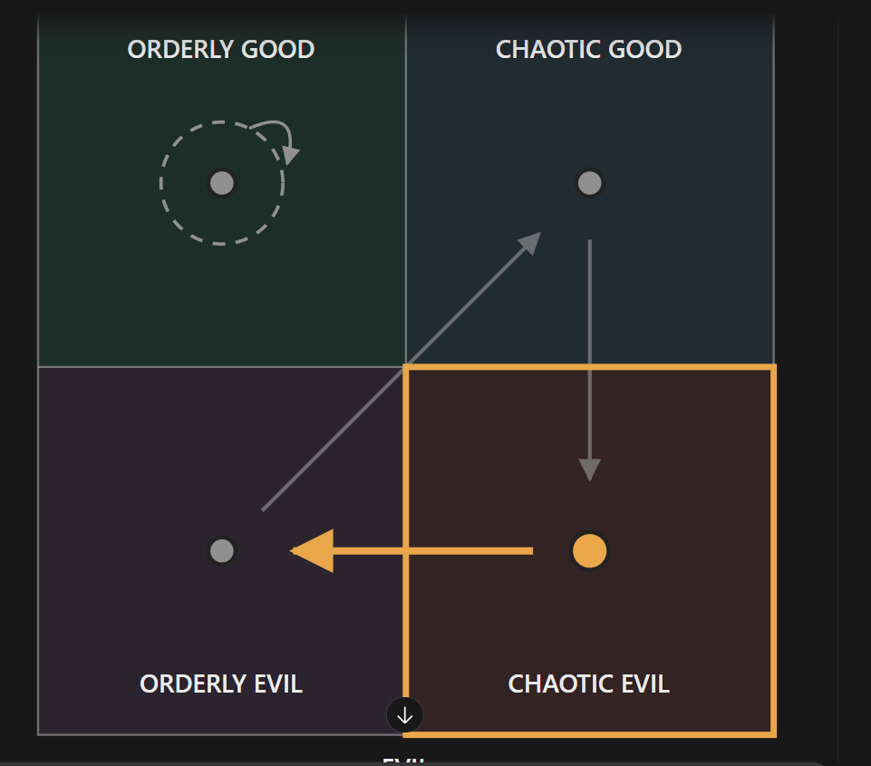

# The ISFJ clinic doctor (unnamed; file is `isfj-f.md` until Rex names them, then it becomes `<slug>.md`)

Every field is marked **(Rex)**, **(proposed)** or **(open)**. Only (Rex) is canon. The field keys in backticks
follow `_TEMPLATE.md`.

- **Slot:** `isfj-f`
- **Status:** idea
- **Last changed:** 2026-10-27

## Identity

| Field | Key | Value | Mark |
|---|---|---|---|
| Name | `name` | | open |
| Type | `type` | ISFJ | Rex |
| Function stack | `stack` | Si-Fe-Ti-Ne | Rex |
| Gender | `gender` | woman | Rex |
| Pirate archetype | `archetype` | | open |
| Ship job (posts held) | `posts` | doctor; runs a small clinic in the starting port | Rex |
| Where they are found | `found_at` | the starting port: the small clinic | Rex |
| Resident or visitor | `town_role` | resident: born in this town | Rex |

## The psycho

| Field | Key | Value | Mark |
|---|---|---|---|
| Psycho core | `psycho_core` | probably a sadistic side: she enjoys healing, but secretly enjoys your suffering; she gets pleasure from healing and from the pain it causes | Rex |
| Madness break | `madness_break` | what they do when the meter crosses the line | open |
| Madness triggers | `madness_triggers` | | open |
| Why piracy allows it | `permission` | how the setting makes it permissible | open |
| Their slight | `slight` | the thing that, repeated, makes them leave | open |
| Clues to the slight | `slight_clues` | obvious, subtle, too late | open |

## The person

| Field | Key | Value | Mark |
|---|---|---|---|
| Bio | `bio` | born in this town; her father was the town doctor; she does her best to keep the townspeople going | Rex |
| Likes (gifts, acts) | `likes` | | open |
| Dislikes | `dislikes` | | open |
| Schedule | `schedule` | their day: post, meals, the den, sleep | open |
| Claims vs truth | `claims` | what they say they're good at, and whether it's true | open |

### Notes (Rex, 2026-10-27)

- **(open)** How she justifies taking pleasure in the pain (Rex: "idk how I'll justify it").
- **(open)** Whether she is the roster's confirmed ISFJ, "the medic who keeps you from leaving".

### The odd triangle (Rex, 2026-10-27)

- **(Rex)** The love situation with her and the ESTP is like an odd triangle: you're meant to wait out the ISFJ's
  infatuation with the ESTP, and eventually she becomes romanceable.
- **(Rex)** Things happen in between, but they are relationship building. She isn't romanceable until she and the
  ESTP have a breaking point.
- **(open)** What the breaking point is, and the in-between events.

## Joining

| Field | Key | Value | Mark |
|---|---|---|---|
| How recruited | `recruit` | recruitable; requires higher reputation before they'll consider joining you, and you must complete sub quests for them (which sub quests are open). Why she joins (Rex): only if you have the ESTP in your party. She sees the ESTP as someone who really needs help; she knows of her living situation and the conditions she keeps her house in, and finds it abhorrent | Rex |
| What the town thinks of them | `town_view` | who likes them, who doesn't (kidnapping consequences) | open |

## Relationships

One row per other character Rex has tied them to. Affection, respect, rivalry, distrust, history.

| With | Key | What it is | Mark |
|---|---|---|---|
| the player | `rel.player` | romanceable only after her infatuation with the ESTP ends (see the triangle below) | Rex |
| the INTJ apothecary (`intj-f`) | `rel.intj-f` | business rivals: her clinic and the INTJ's apothecary compete for the town's healing | Rex |
| the ESTP outdoorswoman (`estp-f`) | `rel.estp-f` | infatuated with her; sees her as someone who really needs help; finds her living situation and the state of her house abhorrent. They eventually reach a breaking point | Rex |

## Heart events

| Hearts | Key | Scene | Mark |
|---|---|---|---|
| | `heart_events` | relationship-building events while you wait out her infatuation with the ESTP (what they are is open); her breaking point with the ESTP, after which she becomes romanceable | Rex (shape); scenes open |

## Voice

| Field | Key | Value | Mark |
|---|---|---|---|
| Speech notes | `voice` | rhythm, vocabulary, what they never say | open |
| Keywords they answer | `keywords` | Morrowind-style topics, and what trust each needs | open |
| Sample lines | `lines` | Rex's lines only | open |

## Art notes (for the art keeper)

| Field | Key | Value | Mark |
|---|---|---|---|
| Look | `art.look` | build, face, hair, scars, outfit, colours | open |
| Signature face | `art.signature_face` | the one expression that is theirs | open |
| Heart-event scenes to illustrate | `art.scenes` | | open |

## Questline responses

How they react to what they witness you do on each of the four questlines (model and matrix:
`../QUESTLINES.md`; town system: `../../town/ENDINGS.md`; personality shifts: `../../STATS.md` §3). Rex,
2026-10-27: conduct on each path decides alignment, and crew who witness it move by their own inner rules.
Rex's rule: a character's nature isn't corrupted by the quest they go on.

| Questline | Key | Reaction to what they witness you do there | Mark |
|---|---|---|---|
| Orderly good (church-like) | `quest.order_good` | leans her toward orderly good; kept up, the lean carries her all the way into it | Rex |
| Chaotic good (the stereotypical pirate town) | `quest.chaos_good` | moves her to chaotic evil | Rex |
| Orderly evil (Cthulhu corruption) | `quest.order_evil` | moves her to chaotic good | Rex |
| Chaotic evil (killers, devil worship) | `quest.chaos_evil` | moves her to orderly evil | Rex |

- **(proposed, outside AI)** Paired developments: compassionate care vs cruelty as treatment.
- **(Rex, 2026-10-28)** The church and the clinic are kept separate (not competitors). Rex may make a new character to compete with the church.

### Inner rules: her alignment map (Rex, 2026-10-28)

What the path you push her on does to her alignment (`../QUESTLINES.md`, model point 4). Rex's diagram:



```
              GOOD
   +-----------------+-----------------+
   |  ORDERLY GOOD   |  CHAOTIC GOOD   |
   |   ( (OG) )      |       (CG)      |
   |                 |    ^    |       |
   +-----------------+---/-----+-------+
   |                 |  /      v       |
   |      (OE) <-----+------- (CE)     |
   |  ORDERLY EVIL   |  CHAOTIC EVIL   |
   +-----------------+-----------------+
              EVIL
   OG no change   CG->CE   OE->CG   CE->OE
```

| Pushed on (action quadrant) | She moves toward | Mark |
|---|---|---|
| Orderly good | orderly good (a lean: kept up, it carries her all the way there) | Rex |
| Chaotic good | chaotic evil | Rex |
| Orderly evil | chaotic good | Rex |
| Chaotic evil | orderly evil | Rex |

For the code (`inner_rules`, action → destination):
`{ "order_good": "order_good", "chaos_good": "chaos_evil", "order_evil": "chaos_good", "chaos_evil": "order_evil" }`

- **(Rex)** The dashed ring: committing that action leans her in that direction. **(Rex, 2026-10-28)** If you keep doing those actions, the lean eventually carries her all the way into that quadrant.
- The other three form a loop: chaotic good → chaotic evil → orderly evil → chaotic good. Only orderly good holds her.
- **(open)** Starting alignment: to figure out later. The diagram highlights chaotic evil (on the CE→OE arrow); Rex hasn't said whether that marks her start (on the ESTP's and ESFP's charts the highlight didn't).

## Change log

| Date | Change | By |
|---|---|---|
| 2026-10-27 | Created: the town's clinic doctor; secretly enjoys the pain healing causes | Rex |
| 2026-10-27 | Questline responses section added | keeper |
| 2026-10-27 | Questline cells reread as reactions to what they witness (was: taking them on a questline → effect) | Rex |
| 2026-10-27 | Joining: requires higher reputation, plus sub quests for them | Rex |
| 2026-10-27 | Why she joins: only with the ESTP in your party. The odd triangle: wait out her infatuation with the ESTP; romanceable after their breaking point | Rex |
| 2026-10-28 | Inner rules: her alignment map (OG no change, CG→CE, OE→CG, CE→OE); tie: her clinic competes with the INTJ's apothecary for the town's healing; the church and clinic kept separate | Rex |
| 2026-10-28 | Dashed ring clarified: the lean toward orderly good, kept up, eventually carries her all the way into it | Rex |
