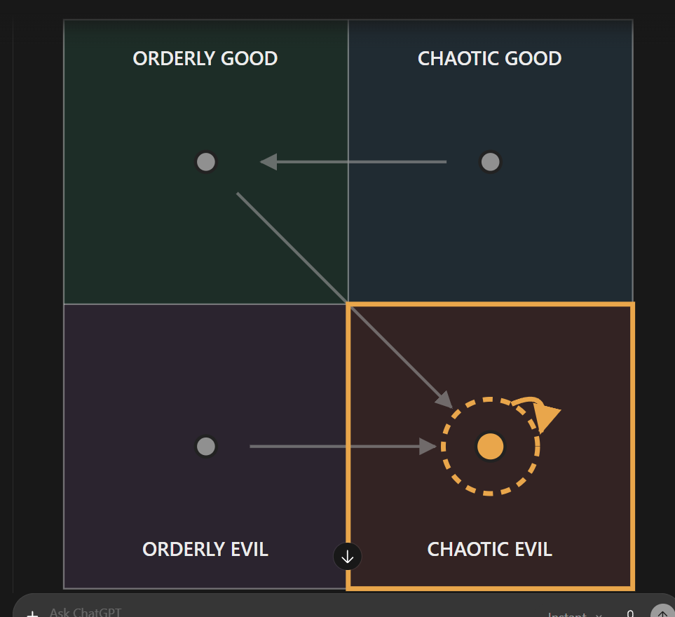

# The ISFP (tentative; unnamed; file is `isfp.md` until Rex sets the gender and name)

Every field is marked **(Rex)**, **(proposed)** or **(open)**. Only (Rex) is canon. The field keys in backticks
follow `_TEMPLATE.md`.

- **Slot:** `isfp-m` or `isfp-f` (gender open)
- **Status:** idea (tentative)
- **Last changed:** 2026-10-28

## Identity

| Field | Key | Value | Mark |
|---|---|---|---|
| Name | `name` | | open |
| Type | `type` | ISFP | Rex |
| Function stack | `stack` | Fi-Se-Ni-Te | Rex |
| Gender | `gender` | | open |
| Pirate archetype | `archetype` | | open |
| Ship job (posts held) | `posts` | competes with the INFP for control of the brothel (tentative) | Rex |
| Where they are found | `found_at` | starting port / later port / at sea | open |
| Resident or visitor | `town_role` | resident, visitor, looking for work | open |

## The psycho

| Field | Key | Value | Mark |
|---|---|---|---|
| Psycho core | `psycho_core` | the type's killer form, in this character | open |
| Madness break | `madness_break` | what they do when the meter crosses the line | open |
| Madness triggers | `madness_triggers` | | open |
| Why piracy allows it | `permission` | how the setting makes it permissible | open |
| Their slight | `slight` | the thing that, repeated, makes them leave | open |
| Clues to the slight | `slight_clues` | obvious, subtle, too late | open |

## The person

| Field | Key | Value | Mark |
|---|---|---|---|
| Bio | `bio` | | open |
| Likes (gifts, acts) | `likes` | | open |
| Dislikes | `dislikes` | | open |
| Schedule | `schedule` | their day: post, meals, the den, sleep | open |
| Claims vs truth | `claims` | what they say they're good at, and whether it's true | open |

## Joining

| Field | Key | Value | Mark |
|---|---|---|---|
| How recruited | `recruit` | hire / mercenary / kidnap; what they need first (rep, proof, gift, questline) | open |
| What the town thinks of them | `town_view` | who likes them, who doesn't (kidnapping consequences) | open |

## Relationships

One row per other character Rex has tied them to. Affection, respect, rivalry, distrust, history.

| With | Key | What it is | Mark |
|---|---|---|---|
| the player | `rel.player` | | open |
| the INFP femboy (`infp-m`) | `rel.infp-m` | rivals: competes with her for control of the brothel (tentative) | Rex (tentative) |

## Heart events

| Hearts | Key | Scene | Mark |
|---|---|---|---|
| | `heart_events` | | open |

## Voice

| Field | Key | Value | Mark |
|---|---|---|---|
| Speech notes | `voice` | rhythm, vocabulary, what they never say | open |
| Keywords they answer | `keywords` | Morrowind-style topics, and what trust each needs | open |
| Sample lines | `lines` | Rex's lines only | open |

## Art notes (for the art keeper)

| Field | Key | Value | Mark |
|---|---|---|---|
| Look | `art.look` | build, face, hair, scars, outfit, colours | open |
| Signature face | `art.signature_face` | the one expression that is theirs | open |
| Heart-event scenes to illustrate | `art.scenes` | | open |

## Questline responses

How they react to what they witness you do on each of the four questlines (model and matrix:
`../QUESTLINES.md`; town system: `../../town/ENDINGS.md`; personality shifts: `../../STATS.md` §3). Rex,
2026-10-27: conduct on each path decides alignment, and crew who witness it move by their own inner rules.
Rex's rule: a character's nature isn't corrupted by the quest they go on.

| Questline | Key | Reaction to what they witness you do there | Mark |
|---|---|---|---|
| Orderly good (church-like) | `quest.order_good` | moves them to chaotic evil | Rex |
| Chaotic good (the stereotypical pirate town) | `quest.chaos_good` | moves them to orderly good | Rex |
| Orderly evil (Cthulhu corruption) | `quest.order_evil` | moves them to chaotic evil | Rex |
| Chaotic evil (killers, devil worship) | `quest.chaos_evil` | leans them toward chaotic evil; kept up, the lean carries them all the way into it | Rex |

### Inner rules: their alignment map (Rex, 2026-10-28)

What the path you push them on does to their alignment (`../QUESTLINES.md`, model point 4). Rex's diagram:



```
              GOOD
   +-----------------+-----------------+
   |  ORDERLY GOOD   |  CHAOTIC GOOD   |
   |      (OG) <-----+------ (CG)      |
   |         \       |                 |
   +----------\------+-----------------+
   |           \     |                 |
   |      (OE) -\----+--> ( (CE) )     |
   |  ORDERLY EVIL   |  CHAOTIC EVIL   |
   +-----------------+-----------------+
              EVIL
   OG->CE   CG->OG   OE->CE   CE lean
```

| Pushed on (action quadrant) | They move toward | Mark |
|---|---|---|
| Orderly good | chaotic evil | Rex |
| Chaotic good | orderly good | Rex |
| Orderly evil | chaotic evil | Rex |
| Chaotic evil | chaotic evil (a lean: kept up, it carries them all the way there) | Rex |

For the code (`inner_rules`, action → destination):
`{ "order_good": "chaos_evil", "chaos_good": "order_good", "order_evil": "chaos_evil", "chaos_evil": "chaos_evil" }`

- **(Rex)** Dashed ring: committing that action leans them that way; kept up, the lean carries them all the way into that quadrant.
- Every path ends in chaotic evil: chaotic good passes through orderly good on the way.
- **(open)** Starting alignment: to figure out later. The diagram highlights chaotic evil; Rex hasn't said whether that marks their start.
- **(open)** Gender, name, story; whether they are recruitable (not counted among the 12).

## Change log

| Date | Change | By |
|---|---|---|
| 2026-10-28 | Created (tentative): the INFP's rival for the brothel; alignment map (OG→CE, CG→OG, OE→CE, CE lean) | Rex |
