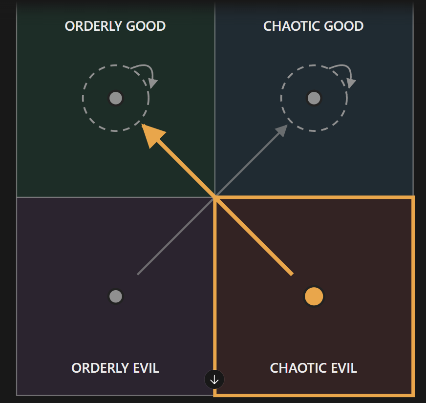

# The ISTJ head priest (unnamed; file is `istj-m.md` until Rex names them, then it becomes `<slug>.md`)

Every field is marked **(Rex)**, **(proposed)** or **(open)**. Only (Rex) is canon. The field keys in backticks
follow `_TEMPLATE.md`.

- **Slot:** `istj-m`
- **Status:** idea
- **Last changed:** 2026-10-28

## Identity

| Field | Key | Value | Mark |
|---|---|---|---|
| Name | `name` | | open |
| Type | `type` | ISTJ | Rex |
| Function stack | `stack` | Si-Te-Fi-Ne | Rex |
| Gender | `gender` | man | Rex |
| Pirate archetype | `archetype` | | open |
| Ship job (posts held) | `posts` | head priest of the church (in town) | Rex |
| Where they are found | `found_at` | the starting port: the church | Rex |
| Resident or visitor | `town_role` | resident: lives at the church | Rex |

## The psycho

| Field | Key | Value | Mark |
|---|---|---|---|
| Psycho core | `psycho_core` | especially cruel when following the rules, to the point of "robtoness" (Rex's word; read as robotic, to confirm) | Rex |
| Madness break | `madness_break` | what they do when the meter crosses the line | open |
| Madness triggers | `madness_triggers` | | open |
| Why piracy allows it | `permission` | how the setting makes it permissible | open |
| Their slight | `slight` | the thing that, repeated, makes them leave | open |
| Clues to the slight | `slight_clues` | obvious, subtle, too late | open |

## The person

| Field | Key | Value | Mark |
|---|---|---|---|
| Bio | `bio` | an old pirate who has given up his pirate life; he despises where he lives | Rex |
| Likes (gifts, acts) | `likes` | | open |
| Dislikes | `dislikes` | | open |
| Schedule | `schedule` | their day: post, meals, the den, sleep | open |
| Claims vs truth | `claims` | what they say they're good at, and whether it's true | open |

### Notes (Rex, 2026-10-27)

- **(Rex, earlier)** The roster's confirmed ISTJ follows the rules to the letter.

## Joining

| Field | Key | Value | Mark |
|---|---|---|---|
| How recruited | `recruit` | recruitable: he offers to join. He sees you as floundering in skills and a bit pathetic, so he joins to help you out, to take measure of you, and hopefully to bring you to God, though he knows you likely won't come | Rex |
| What the town thinks of them | `town_view` | who likes them, who doesn't (kidnapping consequences) | open |

## Relationships

One row per other character Rex has tied them to. Affection, respect, rivalry, distrust, history.

| With | Key | What it is | Mark |
|---|---|---|---|
| the evil ENTJ priest (`entj-m`) | `rel.entj-m` | rivals: the ENTJ competes with him for the church | Rex |
| the player | `rel.player` | sees you as floundering and a bit pathetic; wants to take your measure and bring you to God, expecting to fail | Rex |

## Heart events

| Hearts | Key | Scene | Mark |
|---|---|---|---|
| | `heart_events` | | open |

## Voice

| Field | Key | Value | Mark |
|---|---|---|---|
| Speech notes | `voice` | rhythm, vocabulary, what they never say | open |
| Keywords they answer | `keywords` | Morrowind-style topics, and what trust each needs | open |
| Sample lines | `lines` | Rex's lines only | open |

## Art notes (for the art keeper)

| Field | Key | Value | Mark |
|---|---|---|---|
| Look | `art.look` | build, face, hair, scars, outfit, colours | open |
| Signature face | `art.signature_face` | the one expression that is theirs | open |
| Heart-event scenes to illustrate | `art.scenes` | | open |

## Questline responses

How they react to what they witness you do on each of the four questlines (model and matrix:
`../QUESTLINES.md`; town system: `../../town/ENDINGS.md`; personality shifts: `../../STATS.md` §3). Rex,
2026-10-27: conduct on each path decides alignment, and crew who witness it move by their own inner rules.
Rex's rule: a character's nature isn't corrupted by the quest they go on.

| Questline | Key | Reaction to what they witness you do there | Mark |
|---|---|---|---|
| Orderly good (church-like) | `quest.order_good` | leans him toward orderly good; kept up, the lean carries him all the way into it (map, 2026-10-28); outside AI proposed: supports | Rex |
| Chaotic good (the stereotypical pirate town) | `quest.chaos_good` | no effect: does nothing to his alignment or anyone else's; outside AI proposed: neutral. Map (2026-10-28): a lean toward chaotic good; which stands is open | Rex; conflict open |
| Orderly evil (Cthulhu corruption) | `quest.order_evil` | does nothing to his alignment or anyone else's; outside AI proposed: opposes. Map (2026-10-28): moves him to chaotic good; which stands is open | Rex; conflict open |
| Chaotic evil (killers, devil worship) | `quest.chaos_evil` | he cannot be corrupted: he becomes more fervently against evil and pushes back, moving the town toward good; outside AI proposed: strongly opposes. Map (2026-10-28): moves him to orderly good | Rex |

- **(Rex, 2026-10-27)** The pirate questline is chaotic good; taking him on it does nothing to his alignment or anyone else's.

### Inner rules: his alignment map (Rex, 2026-10-28)

What the path you push him on does to his alignment (`../QUESTLINES.md`, model point 4). Rex's diagram:



```
              GOOD
   +-----------------+-----------------+
   |  ORDERLY GOOD   |  CHAOTIC GOOD   |
   |   ( (OG) )      |   ( (CG) )      |
   |        ^        |    ^            |
   +---------\-------+---/-------------+
   |          \      |  /              |
   |      (OE) \-----+-/----- (CE)     |
   |  ORDERLY EVIL   |  CHAOTIC EVIL   |
   +-----------------+-----------------+
              EVIL
   OG lean   CG lean   OE->CG   CE->OG
```

| Pushed on (action quadrant) | He moves toward | Mark |
|---|---|---|
| Orderly good | orderly good (a lean: kept up, it carries him all the way there) | Rex |
| Chaotic good | chaotic good (a lean: kept up, it carries him all the way there) | Rex |
| Orderly evil | chaotic good | Rex |
| Chaotic evil | orderly good | Rex |

For the code (`inner_rules`, action → destination):
`{ "order_good": "order_good", "chaos_good": "chaos_good", "order_evil": "chaos_good", "chaos_evil": "order_good" }`

- **(Rex)** Dashed ring: committing that action leans him that way; kept up, the lean carries him all the way into that quadrant.
- Every path ends in good: the map never lands on orderly evil or chaotic evil, which fits "he cannot be corrupted".
- **(open, for Rex)** The map differs from the earlier cells above: chaotic good was "no effect" (the map: a lean toward chaotic good); orderly evil "does nothing to his alignment or anyone else's" (the map: moves him to chaotic good); chaotic evil "fights evil harder" (the map: moves him to orderly good; the part about moving the town toward good may still hold). Which stands is Rex's call.
- **(open)** Starting alignment: to figure out later. The diagram highlights chaotic evil (on the CE→OG arrow); Rex hasn't said whether that marks his start.

## Change log

| Date | Change | By |
|---|---|---|
| 2026-10-27 | Created: head priest of the church; despises the town; cruel by the letter of the rules | Rex |
| 2026-10-27 | Questline responses section added (Rex's rules recorded) | keeper |
| 2026-10-27 | Chaotic good (the pirate questline): no effect | Rex |
| 2026-10-27 | Questline cells reread as reactions to what they witness (was: taking them on a questline → effect) | Rex |
| 2026-10-27 | An old pirate who gave up the life; joins of his own offer, to help you, take your measure and try to bring you to God | Rex |
| 2026-10-28 | Inner rules: his alignment map (OG lean, CG lean, OE→CG, CE→OG); where it differs from the earlier cells is open for Rex | Rex |
| 2026-10-28 | Tie: the evil ENTJ priest competes with him for the church | Rex |
